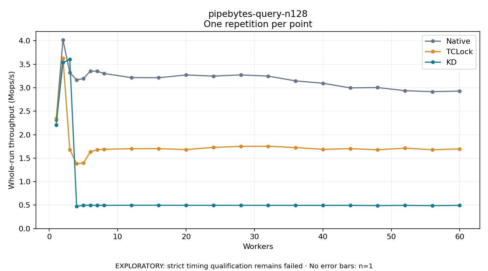

# pipebytes-query-n128

One timed repetition per point; no repeat variability estimate.
EXPLORATORY: strict timing qualification remains failed. Rates include post-lock work. Failed, unrun or score-ineligible cases have no plotted rate.

| Workers | Native Mops/s | TCLock Mops/s | KD Mops/s | KD execution |
| ---: | ---: | ---: | ---: | --- |
| 1 | 2.313 | 2.346 | 2.204 | NO_JIT |
| 2 | 4.020 | 3.629 | 3.538 | NO_JIT |
| 3 | 3.322 | 1.681 | 3.603 | RETURNED_JIT |
| 4 | 3.168 | 1.380 | 0.475 | RETURNED_JIT |
| 5 | 3.194 | 1.396 | 0.496 | RETURNED_JIT |
| 6 | 3.356 | 1.634 | 0.497 | RETURNED_JIT |
| 7 | 3.353 | 1.678 | 0.495 | RETURNED_JIT |
| 8 | 3.303 | 1.690 | 0.495 | RETURNED_JIT |
| 12 | 3.216 | 1.701 | 0.497 | RETURNED_JIT |
| 16 | 3.213 | 1.703 | 0.497 | RETURNED_JIT |
| 20 | 3.272 | 1.682 | 0.495 | RETURNED_JIT |
| 24 | 3.248 | 1.730 | 0.495 | RETURNED_JIT |
| 28 | 3.273 | 1.751 | 0.495 | RETURNED_JIT |
| 32 | 3.248 | 1.754 | 0.495 | RETURNED_JIT |
| 36 | 3.146 | 1.725 | 0.494 | RETURNED_JIT |
| 40 | 3.096 | 1.687 | 0.494 | RETURNED_JIT |
| 44 | 2.997 | 1.702 | 0.494 | RETURNED_JIT |
| 48 | 3.004 | 1.679 | 0.490 | RETURNED_JIT |
| 52 | 2.937 | 1.712 | 0.494 | RETURNED_JIT |
| 56 | 2.916 | 1.680 | 0.489 | RETURNED_JIT |
| 60 | 2.929 | 1.697 | 0.494 | RETURNED_JIT |

[Full receipt table](table.csv)

