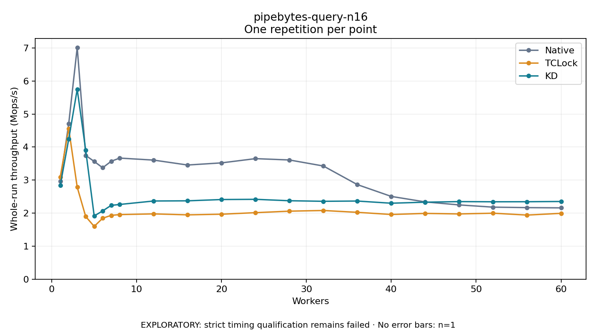

# pipebytes-query-n16

One timed repetition per point; no repeat variability estimate.
EXPLORATORY: strict timing qualification remains failed. Rates include post-lock work. Failed, unrun or score-ineligible cases have no plotted rate.

| Workers | Native Mops/s | TCLock Mops/s | KD Mops/s | KD execution |
| ---: | ---: | ---: | ---: | --- |
| 1 | 2.969 | 3.096 | 2.836 | NO_JIT |
| 2 | 4.709 | 4.558 | 4.241 | NO_JIT |
| 3 | 7.017 | 2.786 | 5.750 | NO_JIT |
| 4 | 3.747 | 1.897 | 3.906 | RETURNED_JIT |
| 5 | 3.565 | 1.598 | 1.914 | RETURNED_JIT |
| 6 | 3.374 | 1.846 | 2.067 | RETURNED_JIT |
| 7 | 3.569 | 1.932 | 2.235 | RETURNED_JIT |
| 8 | 3.666 | 1.955 | 2.262 | RETURNED_JIT |
| 12 | 3.605 | 1.977 | 2.367 | RETURNED_JIT |
| 16 | 3.456 | 1.947 | 2.372 | RETURNED_JIT |
| 20 | 3.521 | 1.967 | 2.411 | RETURNED_JIT |
| 24 | 3.650 | 2.014 | 2.418 | RETURNED_JIT |
| 28 | 3.609 | 2.060 | 2.375 | RETURNED_JIT |
| 32 | 3.426 | 2.079 | 2.358 | RETURNED_JIT |
| 36 | 2.863 | 2.024 | 2.366 | RETURNED_JIT |
| 40 | 2.506 | 1.959 | 2.300 | RETURNED_JIT |
| 44 | 2.340 | 1.991 | 2.331 | RETURNED_JIT |
| 48 | 2.248 | 1.975 | 2.349 | RETURNED_JIT |
| 52 | 2.181 | 1.998 | 2.343 | RETURNED_JIT |
| 56 | 2.167 | 1.941 | 2.345 | RETURNED_JIT |
| 60 | 2.159 | 1.994 | 2.352 | RETURNED_JIT |

[Full receipt table](table.csv)

