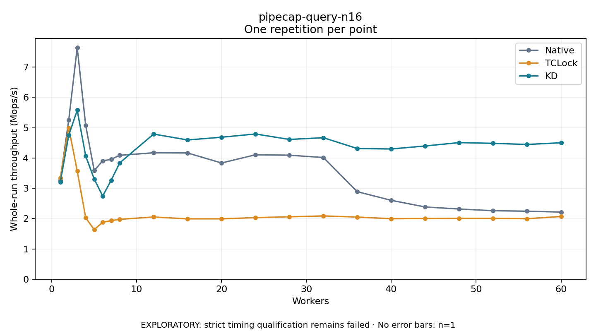

# pipecap-query-n16

One timed repetition per point; no repeat variability estimate.
EXPLORATORY: strict timing qualification remains failed. Rates include post-lock work. Failed, unrun or score-ineligible cases have no plotted rate.

| Workers | Native Mops/s | TCLock Mops/s | KD Mops/s | KD execution |
| ---: | ---: | ---: | ---: | --- |
| 1 | 3.267 | 3.338 | 3.201 | NO_JIT |
| 2 | 5.251 | 4.999 | 4.748 | NO_JIT |
| 3 | 7.645 | 3.574 | 5.577 | NO_JIT |
| 4 | 5.074 | 2.029 | 4.067 | RETURNED_JIT |
| 5 | 3.589 | 1.634 | 3.307 | RETURNED_JIT |
| 6 | 3.906 | 1.880 | 2.745 | RETURNED_JIT |
| 7 | 3.956 | 1.932 | 3.264 | RETURNED_JIT |
| 8 | 4.089 | 1.975 | 3.838 | RETURNED_JIT |
| 12 | 4.172 | 2.054 | 4.790 | RETURNED_JIT |
| 16 | 4.167 | 1.991 | 4.596 | RETURNED_JIT |
| 20 | 3.836 | 1.992 | 4.686 | RETURNED_JIT |
| 24 | 4.106 | 2.033 | 4.793 | RETURNED_JIT |
| 28 | 4.093 | 2.059 | 4.613 | RETURNED_JIT |
| 32 | 4.016 | 2.088 | 4.670 | RETURNED_JIT |
| 36 | 2.888 | 2.050 | 4.313 | RETURNED_JIT |
| 40 | 2.602 | 1.997 | 4.298 | RETURNED_JIT |
| 44 | 2.383 | 2.002 | 4.398 | RETURNED_JIT |
| 48 | 2.316 | 2.009 | 4.508 | RETURNED_JIT |
| 52 | 2.260 | 2.007 | 4.484 | RETURNED_JIT |
| 56 | 2.244 | 1.996 | 4.447 | RETURNED_JIT |
| 60 | 2.215 | 2.069 | 4.503 | RETURNED_JIT |

[Full receipt table](table.csv)

