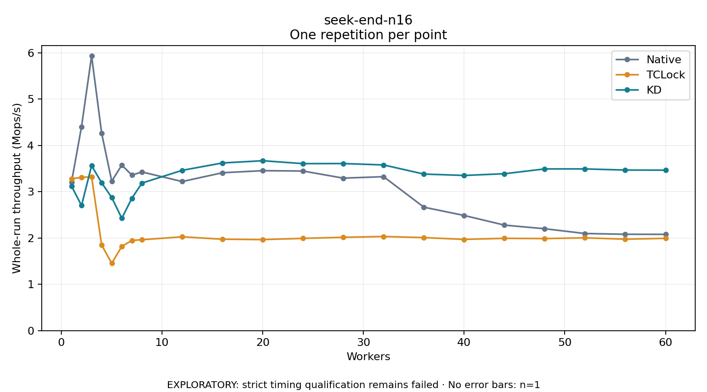

# seek-end-n16

One timed repetition per point; no repeat variability estimate.
EXPLORATORY: strict timing qualification remains failed. Rates include post-lock work. Failed, unrun or score-ineligible cases have no plotted rate.

| Workers | Native Mops/s | TCLock Mops/s | KD Mops/s | KD execution |
| ---: | ---: | ---: | ---: | --- |
| 1 | 3.200 | 3.278 | 3.123 | NO_JIT |
| 2 | 4.403 | 3.309 | 2.701 | NO_JIT |
| 3 | 5.930 | 3.321 | 3.562 | RETURNED_JIT |
| 4 | 4.260 | 1.846 | 3.192 | RETURNED_JIT |
| 5 | 3.227 | 1.454 | 2.873 | RETURNED_JIT |
| 6 | 3.573 | 1.819 | 2.426 | RETURNED_JIT |
| 7 | 3.358 | 1.947 | 2.858 | RETURNED_JIT |
| 8 | 3.425 | 1.963 | 3.186 | RETURNED_JIT |
| 12 | 3.219 | 2.025 | 3.461 | RETURNED_JIT |
| 16 | 3.409 | 1.974 | 3.620 | RETURNED_JIT |
| 20 | 3.453 | 1.965 | 3.668 | RETURNED_JIT |
| 24 | 3.446 | 1.992 | 3.605 | RETURNED_JIT |
| 28 | 3.292 | 2.015 | 3.607 | RETURNED_JIT |
| 32 | 3.324 | 2.032 | 3.577 | RETURNED_JIT |
| 36 | 2.665 | 2.008 | 3.380 | RETURNED_JIT |
| 40 | 2.487 | 1.970 | 3.350 | RETURNED_JIT |
| 44 | 2.278 | 1.993 | 3.387 | RETURNED_JIT |
| 48 | 2.200 | 1.987 | 3.491 | RETURNED_JIT |
| 52 | 2.097 | 2.004 | 3.491 | RETURNED_JIT |
| 56 | 2.081 | 1.974 | 3.466 | RETURNED_JIT |
| 60 | 2.079 | 1.993 | 3.465 | RETURNED_JIT |

[Full receipt table](table.csv)

