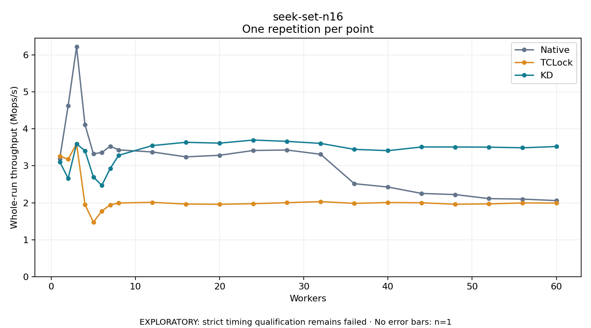

# seek-set-n16

One timed repetition per point; no repeat variability estimate.
EXPLORATORY: strict timing qualification remains failed. Rates include post-lock work. Failed, unrun or score-ineligible cases have no plotted rate.

| Workers | Native Mops/s | TCLock Mops/s | KD Mops/s | KD execution |
| ---: | ---: | ---: | ---: | --- |
| 1 | 3.194 | 3.265 | 3.109 | NO_JIT |
| 2 | 4.626 | 3.177 | 2.660 | NO_JIT |
| 3 | 6.218 | 3.598 | 3.594 | NO_JIT |
| 4 | 4.113 | 1.950 | 3.407 | RETURNED_JIT |
| 5 | 3.324 | 1.475 | 2.697 | RETURNED_JIT |
| 6 | 3.359 | 1.776 | 2.469 | RETURNED_JIT |
| 7 | 3.531 | 1.944 | 2.929 | RETURNED_JIT |
| 8 | 3.430 | 1.993 | 3.284 | RETURNED_JIT |
| 12 | 3.375 | 2.011 | 3.547 | RETURNED_JIT |
| 16 | 3.242 | 1.964 | 3.636 | RETURNED_JIT |
| 20 | 3.284 | 1.958 | 3.613 | RETURNED_JIT |
| 24 | 3.415 | 1.974 | 3.697 | RETURNED_JIT |
| 28 | 3.427 | 2.002 | 3.661 | RETURNED_JIT |
| 32 | 3.312 | 2.031 | 3.606 | RETURNED_JIT |
| 36 | 2.516 | 1.983 | 3.445 | RETURNED_JIT |
| 40 | 2.425 | 2.005 | 3.410 | RETURNED_JIT |
| 44 | 2.252 | 1.999 | 3.509 | RETURNED_JIT |
| 48 | 2.221 | 1.959 | 3.509 | RETURNED_JIT |
| 52 | 2.112 | 1.969 | 3.504 | RETURNED_JIT |
| 56 | 2.098 | 1.995 | 3.487 | RETURNED_JIT |
| 60 | 2.059 | 1.991 | 3.521 | RETURNED_JIT |

[Full receipt table](table.csv)

