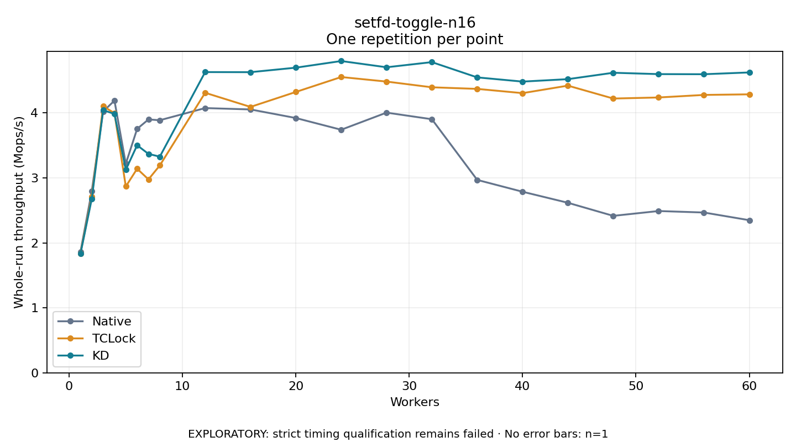

# setfd-toggle-n16

One timed repetition per point; no repeat variability estimate.
EXPLORATORY: strict timing qualification remains failed. Rates include post-lock work. Failed, unrun or score-ineligible cases have no plotted rate.

| Workers | Native Mops/s | TCLock Mops/s | KD Mops/s | KD execution |
| ---: | ---: | ---: | ---: | --- |
| 1 | 1.860 | 1.837 | 1.831 | NO_JIT |
| 2 | 2.798 | 2.713 | 2.680 | NO_JIT |
| 3 | 4.022 | 4.103 | 4.043 | NO_JIT |
| 4 | 4.189 | 3.997 | 3.984 | NO_JIT |
| 5 | 3.218 | 2.868 | 3.126 | NO_JIT |
| 6 | 3.755 | 3.141 | 3.502 | NO_JIT |
| 7 | 3.900 | 2.977 | 3.369 | NO_JIT |
| 8 | 3.888 | 3.191 | 3.327 | NO_JIT |
| 12 | 4.075 | 4.310 | 4.629 | RETURNED_JIT |
| 16 | 4.054 | 4.092 | 4.627 | RETURNED_JIT |
| 20 | 3.921 | 4.323 | 4.696 | RETURNED_JIT |
| 24 | 3.741 | 4.552 | 4.799 | RETURNED_JIT |
| 28 | 4.005 | 4.482 | 4.703 | RETURNED_JIT |
| 32 | 3.903 | 4.394 | 4.782 | RETURNED_JIT |
| 36 | 2.969 | 4.370 | 4.547 | RETURNED_JIT |
| 40 | 2.787 | 4.305 | 4.482 | RETURNED_JIT |
| 44 | 2.617 | 4.420 | 4.520 | RETURNED_JIT |
| 48 | 2.416 | 4.221 | 4.618 | RETURNED_JIT |
| 52 | 2.490 | 4.238 | 4.597 | RETURNED_JIT |
| 56 | 2.467 | 4.277 | 4.596 | RETURNED_JIT |
| 60 | 2.349 | 4.286 | 4.623 | RETURNED_JIT |

[Full receipt table](table.csv)

