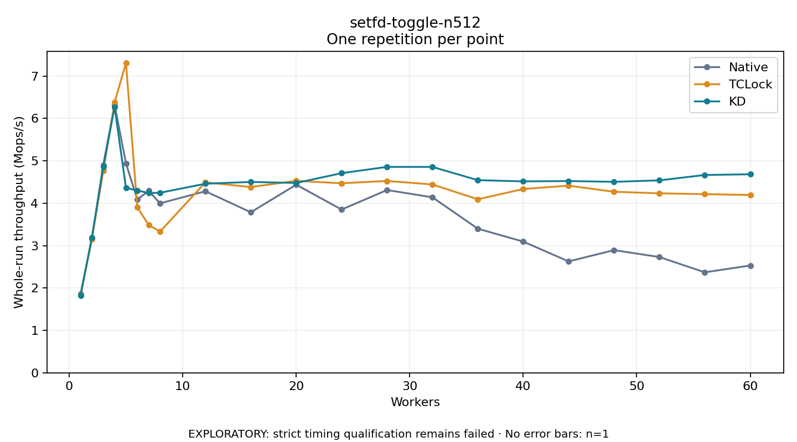

# setfd-toggle-n512

One timed repetition per point; no repeat variability estimate.
EXPLORATORY: strict timing qualification remains failed. Rates include post-lock work. Failed, unrun or score-ineligible cases have no plotted rate.

| Workers | Native Mops/s | TCLock Mops/s | KD Mops/s | KD execution |
| ---: | ---: | ---: | ---: | --- |
| 1 | 1.856 | 1.837 | 1.826 | NO_JIT |
| 2 | 3.161 | 3.155 | 3.194 | NO_JIT |
| 3 | 4.902 | 4.763 | 4.858 | NO_JIT |
| 4 | 6.319 | 6.380 | 6.269 | NO_JIT |
| 5 | 4.942 | 7.306 | 4.363 | NO_JIT |
| 6 | 4.086 | 3.902 | 4.300 | NO_JIT |
| 7 | 4.294 | 3.488 | 4.241 | NO_JIT |
| 8 | 3.997 | 3.329 | 4.246 | NO_JIT |
| 12 | 4.282 | 4.492 | 4.460 | RETURNED_JIT |
| 16 | 3.786 | 4.381 | 4.502 | RETURNED_JIT |
| 20 | 4.436 | 4.528 | 4.478 | RETURNED_JIT |
| 24 | 3.851 | 4.470 | 4.708 | RETURNED_JIT |
| 28 | 4.311 | 4.525 | 4.857 | RETURNED_JIT |
| 32 | 4.139 | 4.442 | 4.856 | RETURNED_JIT |
| 36 | 3.399 | 4.092 | 4.544 | RETURNED_JIT |
| 40 | 3.094 | 4.334 | 4.515 | RETURNED_JIT |
| 44 | 2.628 | 4.414 | 4.523 | RETURNED_JIT |
| 48 | 2.893 | 4.270 | 4.504 | RETURNED_JIT |
| 52 | 2.731 | 4.233 | 4.539 | RETURNED_JIT |
| 56 | 2.370 | 4.213 | 4.666 | RETURNED_JIT |
| 60 | 2.531 | 4.194 | 4.682 | RETURNED_JIT |

[Full receipt table](table.csv)

