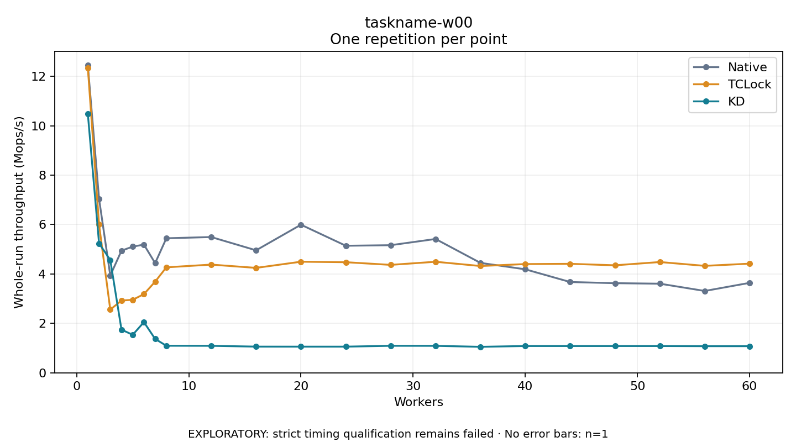

# taskname-w00

One timed repetition per point; no repeat variability estimate.
EXPLORATORY: strict timing qualification remains failed. Rates include post-lock work. Failed, unrun or score-ineligible cases have no plotted rate.

| Workers | Native Mops/s | TCLock Mops/s | KD Mops/s | KD execution |
| ---: | ---: | ---: | ---: | --- |
| 1 | 12.438 | 12.340 | 10.478 | NO_JIT |
| 2 | 7.039 | 5.998 | 5.238 | NO_JIT |
| 3 | 3.938 | 2.559 | 4.566 | NO_JIT |
| 4 | 4.942 | 2.924 | 1.747 | RETURNED_JIT |
| 5 | 5.107 | 2.955 | 1.538 | RETURNED_JIT |
| 6 | 5.187 | 3.184 | 2.050 | RETURNED_JIT |
| 7 | 4.439 | 3.689 | 1.371 | RETURNED_JIT |
| 8 | 5.444 | 4.268 | 1.095 | RETURNED_JIT |
| 12 | 5.494 | 4.379 | 1.092 | RETURNED_JIT |
| 16 | 4.957 | 4.246 | 1.060 | RETURNED_JIT |
| 20 | 5.994 | 4.496 | 1.059 | RETURNED_JIT |
| 24 | 5.142 | 4.475 | 1.059 | RETURNED_JIT |
| 28 | 5.164 | 4.368 | 1.093 | RETURNED_JIT |
| 32 | 5.416 | 4.494 | 1.091 | RETURNED_JIT |
| 36 | 4.448 | 4.322 | 1.052 | RETURNED_JIT |
| 40 | 4.188 | 4.400 | 1.084 | RETURNED_JIT |
| 44 | 3.674 | 4.410 | 1.084 | RETURNED_JIT |
| 48 | 3.627 | 4.351 | 1.084 | RETURNED_JIT |
| 52 | 3.606 | 4.483 | 1.083 | RETURNED_JIT |
| 56 | 3.312 | 4.328 | 1.078 | RETURNED_JIT |
| 60 | 3.640 | 4.417 | 1.078 | RETURNED_JIT |

[Full receipt table](table.csv)

