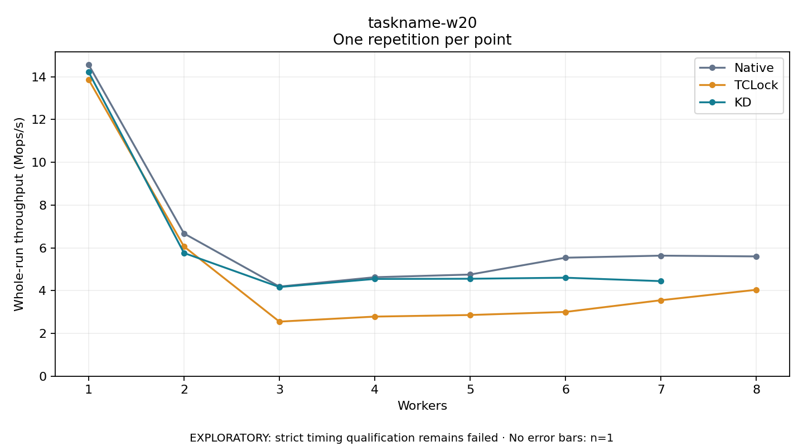

# taskname-w20

One timed repetition per point; no repeat variability estimate.
EXPLORATORY: strict timing qualification remains failed. Rates include post-lock work. Failed, unrun or score-ineligible cases have no plotted rate.

| Workers | Native Mops/s | TCLock Mops/s | KD Mops/s | KD execution |
| ---: | ---: | ---: | ---: | --- |
| 1 | 14.561 | 13.865 | 14.219 | NO_JIT |
| 2 | 6.671 | 6.062 | 5.759 | NO_JIT |
| 3 | 4.188 | 2.551 | 4.166 | NO_JIT |
| 4 | 4.627 | 2.785 | 4.545 | NO_JIT |
| 5 | 4.751 | 2.860 | 4.555 | NO_JIT |
| 6 | 5.538 | 3.003 | 4.603 | NO_JIT |
| 7 | 5.635 | 3.550 | 4.443 | NO_JIT |
| 8 | 5.599 | 4.038 | — | PREPARATION_FAILED |
| 12 | — | — | — | NOT_RUN |
| 16 | — | — | — | NOT_RUN |
| 20 | — | — | — | NOT_RUN |
| 24 | — | — | — | NOT_RUN |
| 28 | — | — | — | NOT_RUN |
| 32 | — | — | — | NOT_RUN |
| 36 | — | — | — | NOT_RUN |
| 40 | — | — | — | NOT_RUN |
| 44 | — | — | — | NOT_RUN |
| 48 | — | — | — | NOT_RUN |
| 52 | — | — | — | NOT_RUN |
| 56 | — | — | — | NOT_RUN |
| 60 | — | — | — | NOT_RUN |

[Full receipt table](table.csv)

