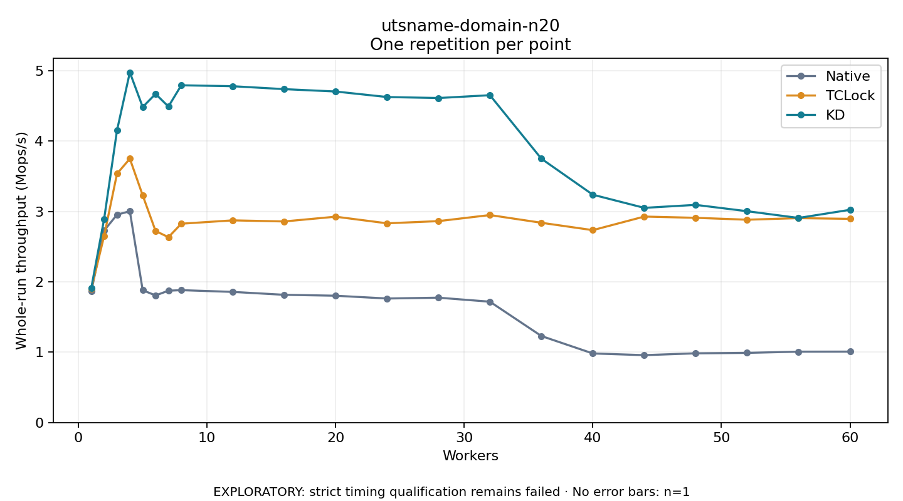

# utsname-domain-n20

One timed repetition per point; no repeat variability estimate.
EXPLORATORY: strict timing qualification remains failed. Rates include post-lock work. Failed, unrun or score-ineligible cases have no plotted rate.

| Workers | Native Mops/s | TCLock Mops/s | KD Mops/s | KD execution |
| ---: | ---: | ---: | ---: | --- |
| 1 | 1.862 | 1.901 | 1.911 | NO_JIT |
| 2 | 2.728 | 2.652 | 2.893 | NO_JIT |
| 3 | 2.954 | 3.536 | 4.151 | NO_JIT |
| 4 | 3.003 | 3.750 | 4.976 | NO_JIT |
| 5 | 1.880 | 3.229 | 4.484 | NO_JIT |
| 6 | 1.807 | 2.723 | 4.670 | NO_JIT |
| 7 | 1.874 | 2.634 | 4.491 | NO_JIT |
| 8 | 1.882 | 2.826 | 4.793 | NO_JIT |
| 12 | 1.857 | 2.874 | 4.780 | RETURNED_JIT |
| 16 | 1.816 | 2.858 | 4.738 | RETURNED_JIT |
| 20 | 1.802 | 2.926 | 4.705 | RETURNED_JIT |
| 24 | 1.763 | 2.831 | 4.626 | RETURNED_JIT |
| 28 | 1.775 | 2.863 | 4.612 | RETURNED_JIT |
| 32 | 1.718 | 2.949 | 4.652 | RETURNED_JIT |
| 36 | 1.230 | 2.839 | 3.750 | RETURNED_JIT |
| 40 | 0.982 | 2.734 | 3.238 | RETURNED_JIT |
| 44 | 0.958 | 2.927 | 3.051 | RETURNED_JIT |
| 48 | 0.984 | 2.910 | 3.094 | RETURNED_JIT |
| 52 | 0.990 | 2.883 | 3.003 | RETURNED_JIT |
| 56 | 1.008 | 2.905 | 2.908 | RETURNED_JIT |
| 60 | 1.008 | 2.895 | 3.023 | RETURNED_JIT |

[Full receipt table](table.csv)

