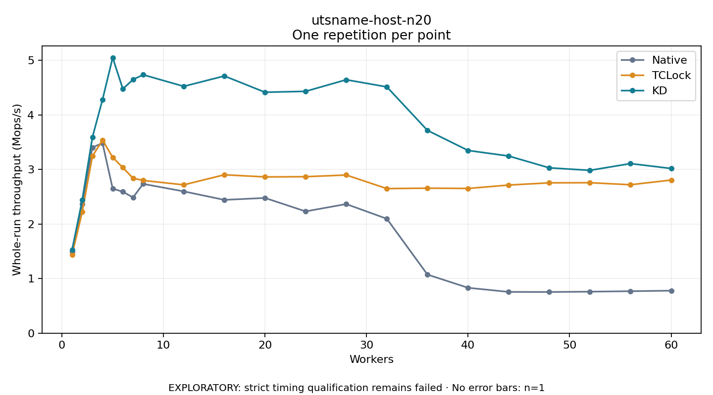

# utsname-host-n20

One timed repetition per point; no repeat variability estimate.
EXPLORATORY: strict timing qualification remains failed. Rates include post-lock work. Failed, unrun or score-ineligible cases have no plotted rate.

| Workers | Native Mops/s | TCLock Mops/s | KD Mops/s | KD execution |
| ---: | ---: | ---: | ---: | --- |
| 1 | 1.489 | 1.437 | 1.527 | NO_JIT |
| 2 | 2.371 | 2.223 | 2.439 | NO_JIT |
| 3 | 3.406 | 3.245 | 3.589 | NO_JIT |
| 4 | 3.484 | 3.538 | 4.283 | NO_JIT |
| 5 | 2.649 | 3.224 | 5.051 | NO_JIT |
| 6 | 2.593 | 3.035 | 4.478 | NO_JIT |
| 7 | 2.487 | 2.841 | 4.649 | NO_JIT |
| 8 | 2.737 | 2.799 | 4.737 | NO_JIT |
| 12 | 2.599 | 2.719 | 4.525 | RETURNED_JIT |
| 16 | 2.443 | 2.904 | 4.715 | RETURNED_JIT |
| 20 | 2.479 | 2.864 | 4.417 | RETURNED_JIT |
| 24 | 2.233 | 2.869 | 4.433 | RETURNED_JIT |
| 28 | 2.367 | 2.899 | 4.646 | RETURNED_JIT |
| 32 | 2.097 | 2.650 | 4.515 | RETURNED_JIT |
| 36 | 1.074 | 2.658 | 3.717 | RETURNED_JIT |
| 40 | 0.832 | 2.653 | 3.350 | RETURNED_JIT |
| 44 | 0.756 | 2.715 | 3.247 | RETURNED_JIT |
| 48 | 0.755 | 2.756 | 3.031 | RETURNED_JIT |
| 52 | 0.761 | 2.758 | 2.985 | RETURNED_JIT |
| 56 | 0.769 | 2.721 | 3.109 | RETURNED_JIT |
| 60 | 0.779 | 2.807 | 3.019 | RETURNED_JIT |

[Full receipt table](table.csv)

