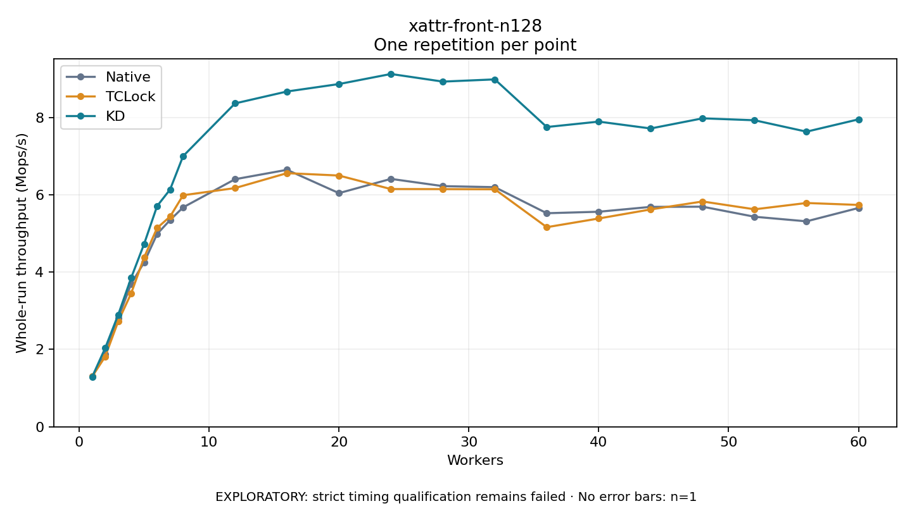

# xattr-front-n128

One timed repetition per point; no repeat variability estimate.
EXPLORATORY: strict timing qualification remains failed. Rates include post-lock work. Failed, unrun or score-ineligible cases have no plotted rate.

| Workers | Native Mops/s | TCLock Mops/s | KD Mops/s | KD execution |
| ---: | ---: | ---: | ---: | --- |
| 1 | 1.301 | 1.298 | 1.291 | NO_JIT |
| 2 | 1.872 | 1.815 | 2.034 | NO_JIT |
| 3 | 2.804 | 2.722 | 2.893 | NO_JIT |
| 4 | 3.697 | 3.449 | 3.849 | NO_JIT |
| 5 | 4.250 | 4.380 | 4.728 | NO_JIT |
| 6 | 4.984 | 5.140 | 5.707 | NO_JIT |
| 7 | 5.346 | 5.435 | 6.135 | NO_JIT |
| 8 | 5.672 | 5.986 | 6.997 | NO_JIT |
| 12 | 6.401 | 6.172 | 8.361 | NO_JIT |
| 16 | 6.644 | 6.557 | 8.669 | NO_JIT |
| 20 | 6.041 | 6.496 | 8.861 | NO_JIT |
| 24 | 6.409 | 6.146 | 9.122 | NO_JIT |
| 28 | 6.222 | 6.144 | 8.924 | NO_JIT |
| 32 | 6.195 | 6.141 | 8.982 | NO_JIT |
| 36 | 5.521 | 5.160 | 7.750 | NO_JIT |
| 40 | 5.560 | 5.385 | 7.890 | NO_JIT |
| 44 | 5.685 | 5.620 | 7.713 | NO_JIT |
| 48 | 5.690 | 5.825 | 7.975 | NO_JIT |
| 52 | 5.430 | 5.623 | 7.925 | NO_JIT |
| 56 | 5.312 | 5.786 | 7.630 | NO_JIT |
| 60 | 5.657 | 5.736 | 7.948 | NO_JIT |

[Full receipt table](table.csv)

