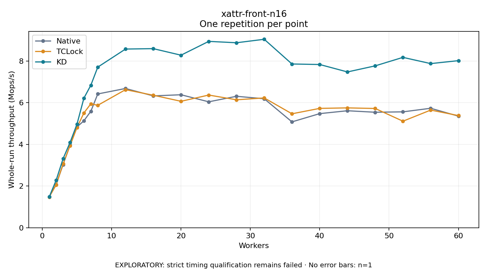

# xattr-front-n16

One timed repetition per point; no repeat variability estimate.
EXPLORATORY: strict timing qualification remains failed. Rates include post-lock work. Failed, unrun or score-ineligible cases have no plotted rate.

| Workers | Native Mops/s | TCLock Mops/s | KD Mops/s | KD execution |
| ---: | ---: | ---: | ---: | --- |
| 1 | 1.484 | 1.474 | 1.478 | NO_JIT |
| 2 | 2.074 | 2.057 | 2.279 | NO_JIT |
| 3 | 3.031 | 3.066 | 3.313 | NO_JIT |
| 4 | 3.955 | 3.935 | 4.087 | NO_JIT |
| 5 | 4.832 | 4.806 | 4.965 | NO_JIT |
| 6 | 5.131 | 5.506 | 6.216 | NO_JIT |
| 7 | 5.585 | 5.944 | 6.835 | NO_JIT |
| 8 | 6.417 | 5.872 | 7.704 | NO_JIT |
| 12 | 6.679 | 6.623 | 8.571 | NO_JIT |
| 16 | 6.324 | 6.356 | 8.591 | NO_JIT |
| 20 | 6.379 | 6.065 | 8.277 | NO_JIT |
| 24 | 6.040 | 6.365 | 8.939 | NO_JIT |
| 28 | 6.305 | 6.137 | 8.873 | NO_JIT |
| 32 | 6.187 | 6.226 | 9.040 | NO_JIT |
| 36 | 5.078 | 5.466 | 7.854 | NO_JIT |
| 40 | 5.474 | 5.725 | 7.830 | NO_JIT |
| 44 | 5.612 | 5.749 | 7.473 | NO_JIT |
| 48 | 5.540 | 5.720 | 7.765 | NO_JIT |
| 52 | 5.559 | 5.110 | 8.172 | NO_JIT |
| 56 | 5.730 | 5.644 | 7.873 | NO_JIT |
| 60 | 5.352 | 5.380 | 8.014 | NO_JIT |

[Full receipt table](table.csv)

