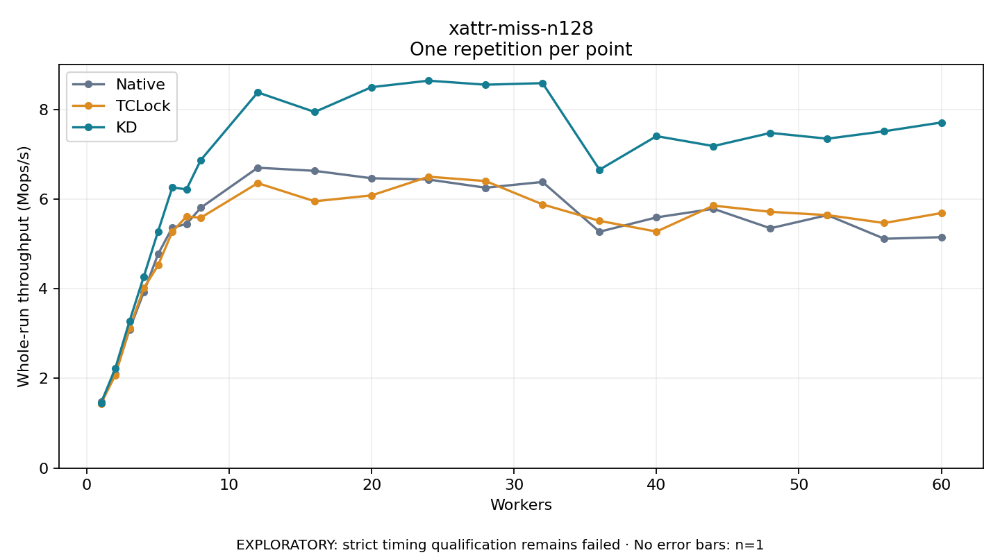

# xattr-miss-n128

One timed repetition per point; no repeat variability estimate.
EXPLORATORY: strict timing qualification remains failed. Rates include post-lock work. Failed, unrun or score-ineligible cases have no plotted rate.

| Workers | Native Mops/s | TCLock Mops/s | KD Mops/s | KD execution |
| ---: | ---: | ---: | ---: | --- |
| 1 | 1.477 | 1.442 | 1.452 | NO_JIT |
| 2 | 2.102 | 2.076 | 2.228 | NO_JIT |
| 3 | 3.094 | 3.121 | 3.279 | NO_JIT |
| 4 | 3.925 | 4.012 | 4.272 | NO_JIT |
| 5 | 4.771 | 4.523 | 5.278 | NO_JIT |
| 6 | 5.364 | 5.272 | 6.258 | NO_JIT |
| 7 | 5.445 | 5.613 | 6.218 | NO_JIT |
| 8 | 5.807 | 5.585 | 6.870 | NO_JIT |
| 12 | 6.700 | 6.356 | 8.380 | NO_JIT |
| 16 | 6.630 | 5.951 | 7.943 | NO_JIT |
| 20 | 6.465 | 6.083 | 8.497 | NO_JIT |
| 24 | 6.436 | 6.499 | 8.641 | NO_JIT |
| 28 | 6.254 | 6.402 | 8.551 | NO_JIT |
| 32 | 6.383 | 5.882 | 8.586 | NO_JIT |
| 36 | 5.272 | 5.515 | 6.656 | NO_JIT |
| 40 | 5.592 | 5.275 | 7.404 | NO_JIT |
| 44 | 5.784 | 5.854 | 7.182 | NO_JIT |
| 48 | 5.349 | 5.716 | 7.476 | NO_JIT |
| 52 | 5.643 | 5.643 | 7.347 | NO_JIT |
| 56 | 5.115 | 5.467 | 7.513 | NO_JIT |
| 60 | 5.151 | 5.688 | 7.709 | NO_JIT |

[Full receipt table](table.csv)

