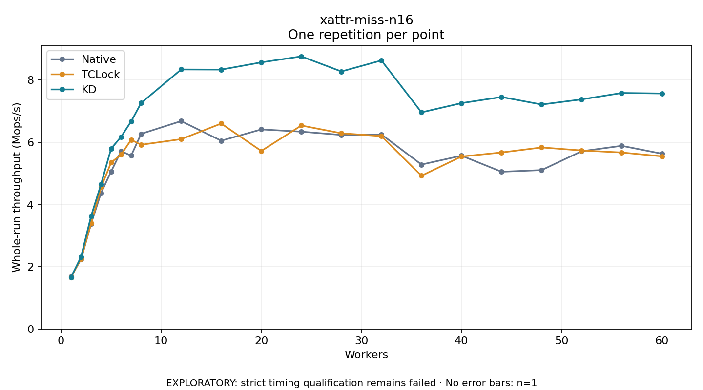

# xattr-miss-n16

One timed repetition per point; no repeat variability estimate.
EXPLORATORY: strict timing qualification remains failed. Rates include post-lock work. Failed, unrun or score-ineligible cases have no plotted rate.

| Workers | Native Mops/s | TCLock Mops/s | KD Mops/s | KD execution |
| ---: | ---: | ---: | ---: | --- |
| 1 | 1.682 | 1.659 | 1.664 | NO_JIT |
| 2 | 2.240 | 2.261 | 2.320 | NO_JIT |
| 3 | 3.380 | 3.395 | 3.626 | NO_JIT |
| 4 | 4.374 | 4.550 | 4.657 | NO_JIT |
| 5 | 5.059 | 5.351 | 5.795 | NO_JIT |
| 6 | 5.716 | 5.603 | 6.177 | NO_JIT |
| 7 | 5.571 | 6.079 | 6.670 | NO_JIT |
| 8 | 6.272 | 5.921 | 7.264 | NO_JIT |
| 12 | 6.681 | 6.101 | 8.341 | NO_JIT |
| 16 | 6.051 | 6.602 | 8.337 | NO_JIT |
| 20 | 6.414 | 5.722 | 8.570 | NO_JIT |
| 24 | 6.342 | 6.539 | 8.761 | NO_JIT |
| 28 | 6.237 | 6.291 | 8.277 | NO_JIT |
| 32 | 6.253 | 6.199 | 8.631 | NO_JIT |
| 36 | 5.284 | 4.925 | 6.963 | NO_JIT |
| 40 | 5.569 | 5.543 | 7.259 | NO_JIT |
| 44 | 5.054 | 5.673 | 7.456 | NO_JIT |
| 48 | 5.106 | 5.834 | 7.215 | NO_JIT |
| 52 | 5.713 | 5.737 | 7.380 | NO_JIT |
| 56 | 5.887 | 5.672 | 7.585 | NO_JIT |
| 60 | 5.635 | 5.549 | 7.569 | NO_JIT |

[Full receipt table](table.csv)

