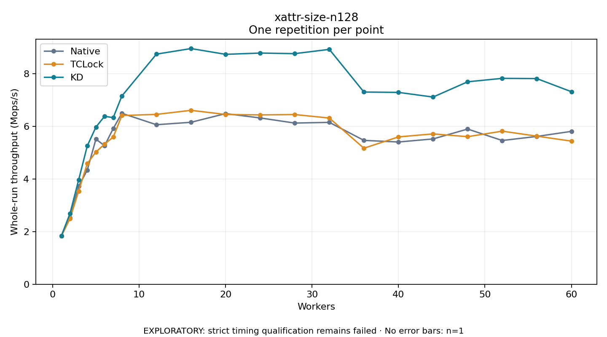

# xattr-size-n128

One timed repetition per point; no repeat variability estimate.
EXPLORATORY: strict timing qualification remains failed. Rates include post-lock work. Failed, unrun or score-ineligible cases have no plotted rate.

| Workers | Native Mops/s | TCLock Mops/s | KD Mops/s | KD execution |
| ---: | ---: | ---: | ---: | --- |
| 1 | 1.833 | 1.835 | 1.841 | NO_JIT |
| 2 | 2.523 | 2.496 | 2.691 | NO_JIT |
| 3 | 3.727 | 3.543 | 3.968 | NO_JIT |
| 4 | 4.344 | 4.590 | 5.265 | NO_JIT |
| 5 | 5.520 | 5.031 | 5.978 | NO_JIT |
| 6 | 5.267 | 5.330 | 6.390 | NO_JIT |
| 7 | 5.922 | 5.598 | 6.336 | NO_JIT |
| 8 | 6.503 | 6.418 | 7.160 | NO_JIT |
| 12 | 6.068 | 6.460 | 8.753 | NO_JIT |
| 16 | 6.160 | 6.616 | 8.965 | NO_JIT |
| 20 | 6.490 | 6.458 | 8.745 | NO_JIT |
| 24 | 6.325 | 6.441 | 8.793 | NO_JIT |
| 28 | 6.131 | 6.455 | 8.772 | NO_JIT |
| 32 | 6.157 | 6.322 | 8.934 | NO_JIT |
| 36 | 5.472 | 5.174 | 7.311 | NO_JIT |
| 40 | 5.411 | 5.604 | 7.297 | NO_JIT |
| 44 | 5.527 | 5.719 | 7.120 | NO_JIT |
| 48 | 5.903 | 5.613 | 7.701 | NO_JIT |
| 52 | 5.468 | 5.823 | 7.832 | NO_JIT |
| 56 | 5.622 | 5.634 | 7.823 | NO_JIT |
| 60 | 5.815 | 5.444 | 7.324 | NO_JIT |

[Full receipt table](table.csv)

