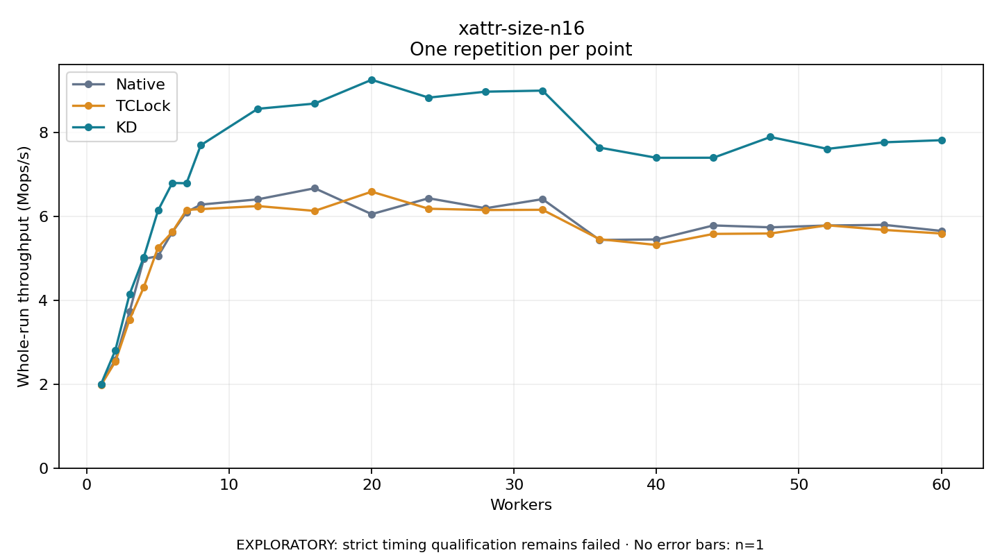

# xattr-size-n16

One timed repetition per point; no repeat variability estimate.
EXPLORATORY: strict timing qualification remains failed. Rates include post-lock work. Failed, unrun or score-ineligible cases have no plotted rate.

| Workers | Native Mops/s | TCLock Mops/s | KD Mops/s | KD execution |
| ---: | ---: | ---: | ---: | --- |
| 1 | 1.990 | 1.981 | 2.005 | NO_JIT |
| 2 | 2.582 | 2.538 | 2.807 | NO_JIT |
| 3 | 3.727 | 3.540 | 4.144 | NO_JIT |
| 4 | 4.988 | 4.313 | 5.028 | NO_JIT |
| 5 | 5.053 | 5.260 | 6.142 | NO_JIT |
| 6 | 5.623 | 5.630 | 6.798 | NO_JIT |
| 7 | 6.101 | 6.156 | 6.792 | NO_JIT |
| 8 | 6.283 | 6.175 | 7.698 | NO_JIT |
| 12 | 6.408 | 6.247 | 8.566 | NO_JIT |
| 16 | 6.672 | 6.132 | 8.691 | NO_JIT |
| 20 | 6.055 | 6.590 | 9.258 | NO_JIT |
| 24 | 6.434 | 6.184 | 8.833 | NO_JIT |
| 28 | 6.196 | 6.153 | 8.974 | NO_JIT |
| 32 | 6.413 | 6.159 | 9.000 | NO_JIT |
| 36 | 5.441 | 5.458 | 7.642 | NO_JIT |
| 40 | 5.452 | 5.320 | 7.398 | NO_JIT |
| 44 | 5.786 | 5.584 | 7.400 | NO_JIT |
| 48 | 5.741 | 5.594 | 7.894 | NO_JIT |
| 52 | 5.784 | 5.789 | 7.611 | NO_JIT |
| 56 | 5.799 | 5.679 | 7.768 | NO_JIT |
| 60 | 5.656 | 5.594 | 7.818 | NO_JIT |

[Full receipt table](table.csv)

