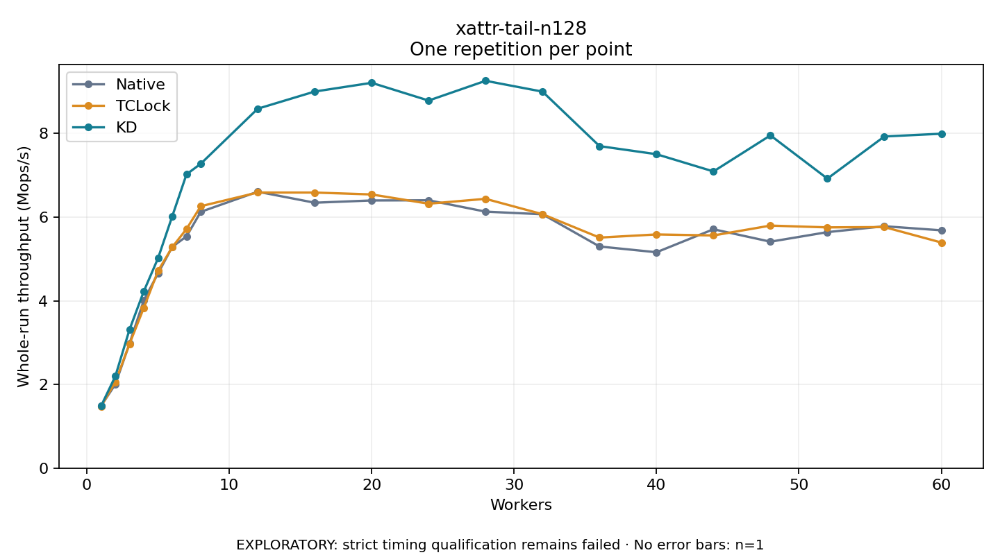

# xattr-tail-n128

One timed repetition per point; no repeat variability estimate.
EXPLORATORY: strict timing qualification remains failed. Rates include post-lock work. Failed, unrun or score-ineligible cases have no plotted rate.

| Workers | Native Mops/s | TCLock Mops/s | KD Mops/s | KD execution |
| ---: | ---: | ---: | ---: | --- |
| 1 | 1.488 | 1.479 | 1.484 | NO_JIT |
| 2 | 2.001 | 2.055 | 2.194 | NO_JIT |
| 3 | 2.981 | 2.971 | 3.314 | NO_JIT |
| 4 | 4.010 | 3.830 | 4.225 | NO_JIT |
| 5 | 4.654 | 4.714 | 5.016 | NO_JIT |
| 6 | 5.288 | 5.281 | 6.021 | NO_JIT |
| 7 | 5.539 | 5.715 | 7.022 | NO_JIT |
| 8 | 6.125 | 6.259 | 7.274 | NO_JIT |
| 12 | 6.606 | 6.587 | 8.590 | NO_JIT |
| 16 | 6.343 | 6.586 | 9.000 | NO_JIT |
| 20 | 6.397 | 6.540 | 9.208 | NO_JIT |
| 24 | 6.401 | 6.319 | 8.785 | NO_JIT |
| 28 | 6.129 | 6.436 | 9.257 | NO_JIT |
| 32 | 6.067 | 6.068 | 8.997 | NO_JIT |
| 36 | 5.297 | 5.510 | 7.696 | NO_JIT |
| 40 | 5.159 | 5.585 | 7.503 | NO_JIT |
| 44 | 5.709 | 5.560 | 7.090 | NO_JIT |
| 48 | 5.411 | 5.796 | 7.953 | NO_JIT |
| 52 | 5.640 | 5.753 | 6.919 | NO_JIT |
| 56 | 5.781 | 5.761 | 7.926 | NO_JIT |
| 60 | 5.683 | 5.392 | 7.992 | NO_JIT |

[Full receipt table](table.csv)

