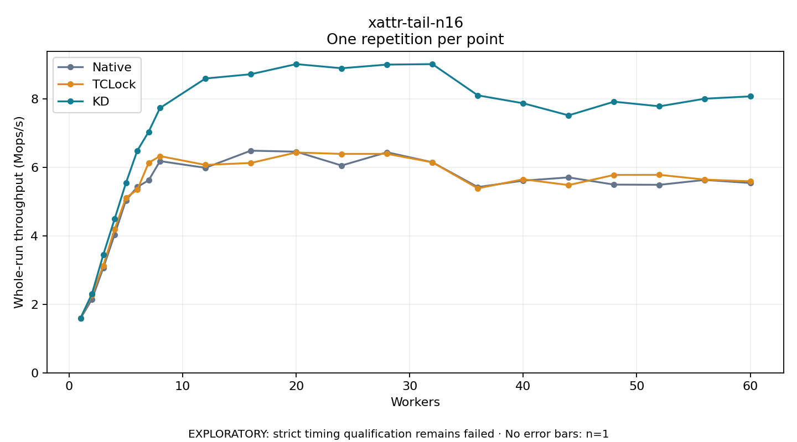

# xattr-tail-n16

One timed repetition per point; no repeat variability estimate.
EXPLORATORY: strict timing qualification remains failed. Rates include post-lock work. Failed, unrun or score-ineligible cases have no plotted rate.

| Workers | Native Mops/s | TCLock Mops/s | KD Mops/s | KD execution |
| ---: | ---: | ---: | ---: | --- |
| 1 | 1.591 | 1.590 | 1.602 | NO_JIT |
| 2 | 2.146 | 2.271 | 2.304 | NO_JIT |
| 3 | 3.064 | 3.130 | 3.447 | NO_JIT |
| 4 | 4.040 | 4.194 | 4.495 | NO_JIT |
| 5 | 5.041 | 5.118 | 5.549 | NO_JIT |
| 6 | 5.431 | 5.349 | 6.492 | NO_JIT |
| 7 | 5.626 | 6.139 | 7.044 | NO_JIT |
| 8 | 6.186 | 6.333 | 7.739 | NO_JIT |
| 12 | 5.990 | 6.076 | 8.601 | NO_JIT |
| 16 | 6.492 | 6.132 | 8.726 | NO_JIT |
| 20 | 6.463 | 6.439 | 9.022 | NO_JIT |
| 24 | 6.057 | 6.398 | 8.900 | NO_JIT |
| 28 | 6.445 | 6.399 | 9.007 | NO_JIT |
| 32 | 6.152 | 6.151 | 9.021 | NO_JIT |
| 36 | 5.427 | 5.391 | 8.108 | NO_JIT |
| 40 | 5.615 | 5.655 | 7.876 | NO_JIT |
| 44 | 5.710 | 5.486 | 7.523 | NO_JIT |
| 48 | 5.500 | 5.783 | 7.923 | NO_JIT |
| 52 | 5.494 | 5.785 | 7.789 | NO_JIT |
| 56 | 5.637 | 5.646 | 8.011 | NO_JIT |
| 60 | 5.547 | 5.596 | 8.079 | NO_JIT |

[Full receipt table](table.csv)

