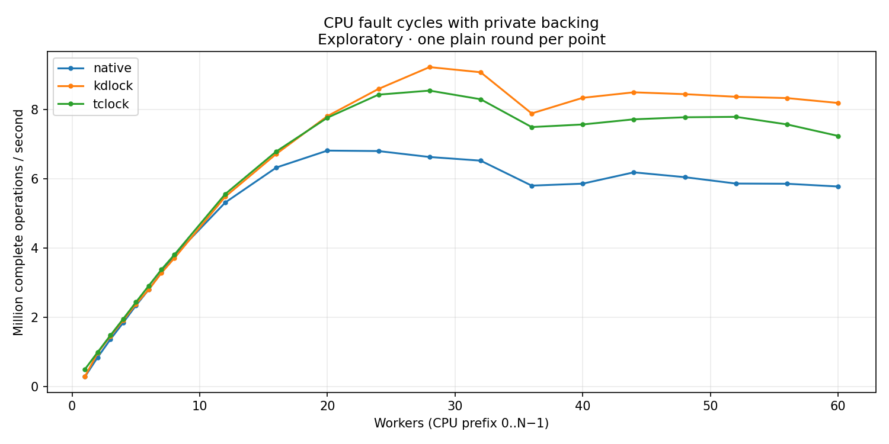

# CPU fault cycles with private backing

MADV_DONTNEED plus checked CPU read, including PTE reset. Native, KD and TCLock backing readers execute locally on the original task; this is not shared-mm writer delegation. Kernel `6.1.159-kdclobber2`; source `e74223c8c0d0a1f72f2c7d87560b37c3125a23f5`.

Exactly one plain round per point. Strict host timing qualification is failed; auxiliary QEMU workers use CPU 63. No variance estimate or latency samples. Rates use complete operations divided by whole wall time. Missing optional positive-cohort peak windows do not invalidate exact aggregate accounting or drain.

[CSV](table.csv) · [SVG](throughput.svg)

| Workers | native Mops/s | kdlock Mops/s | tclock Mops/s |
| --- | ---: | ---: | ---: |
| 1 | 0.277807 | 0.282445 | 0.493491 |
| 2 | 0.840615 | 0.967575 | 0.988326 |
| 3 | 1.359090 | 1.451482 | 1.474761 |
| 4 | 1.839903 | 1.906479 | 1.949243 |
| 5 | 2.336214 | 2.378686 | 2.431992 |
| 6 | 2.795931 | 2.793833 | 2.904848 |
| 7 | 3.291731 | 3.278430 | 3.376027 |
| 8 | 3.774522 | 3.699691 | 3.798609 |
| 12 | 5.311525 | 5.480554 | 5.556761 |
| 16 | 6.320300 | 6.715200 | 6.786482 |
| 20 | 6.809061 | 7.805046 | 7.758981 |
| 24 | 6.795475 | 8.589835 | 8.424496 |
| 28 | 6.624117 | 9.219903 | 8.541333 |
| 32 | 6.519048 | 9.071310 | 8.291815 |
| 36 | 5.797391 | 7.881939 | 7.488290 |
| 40 | 5.854364 | 8.333010 | 7.563484 |
| 44 | 6.180811 | 8.492093 | 7.712210 |
| 48 | 6.041656 | 8.438472 | 7.771346 |
| 52 | 5.857145 | 8.363194 | 7.783841 |
| 56 | 5.851429 | 8.325639 | 7.565274 |
| 60 | 5.772332 | 8.184430 | 7.233381 |
