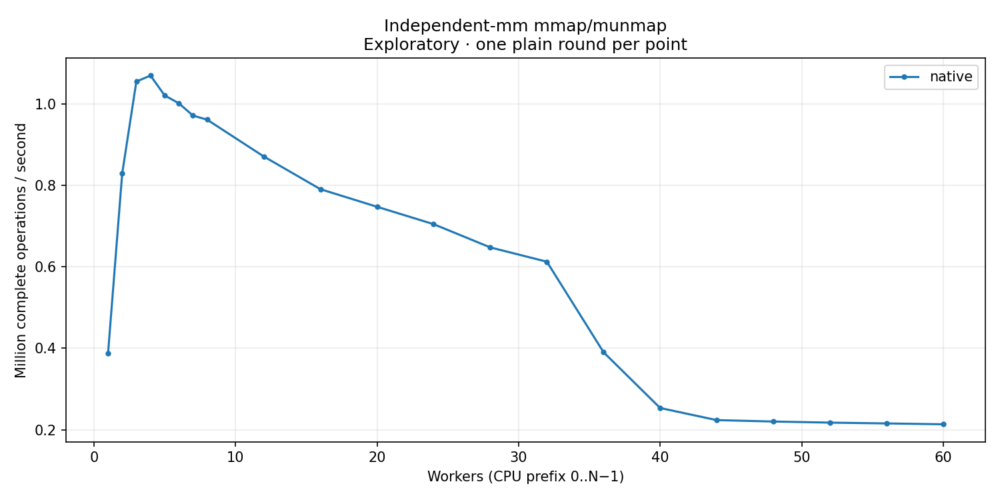

# Independent-mm mmap/munmap

Native mmap/munmap without page access; independent address spaces. No backing-lock operation. Kernel `6.1.159-kdclobber2`; source `e74223c8c0d0a1f72f2c7d87560b37c3125a23f5`.

Exactly one plain round per point. Strict host timing qualification is failed; auxiliary QEMU workers use CPU 63. No variance estimate or latency samples. Rates use complete operations divided by whole wall time. Missing optional positive-cohort peak windows do not invalidate exact aggregate accounting or drain.

[CSV](table.csv) · [SVG](throughput.svg)

| Workers | native Mops/s |
| --- | ---: |
| 1 | 0.387208 |
| 2 | 0.829129 |
| 3 | 1.054786 |
| 4 | 1.069449 |
| 5 | 1.020673 |
| 6 | 1.001503 |
| 7 | 0.971209 |
| 8 | 0.961227 |
| 12 | 0.870885 |
| 16 | 0.790623 |
| 20 | 0.747439 |
| 24 | 0.704746 |
| 28 | 0.647720 |
| 32 | 0.612591 |
| 36 | 0.390589 |
| 40 | 0.253578 |
| 44 | 0.223798 |
| 48 | 0.220384 |
| 52 | 0.217622 |
| 56 | 0.215698 |
| 60 | 0.213577 |
