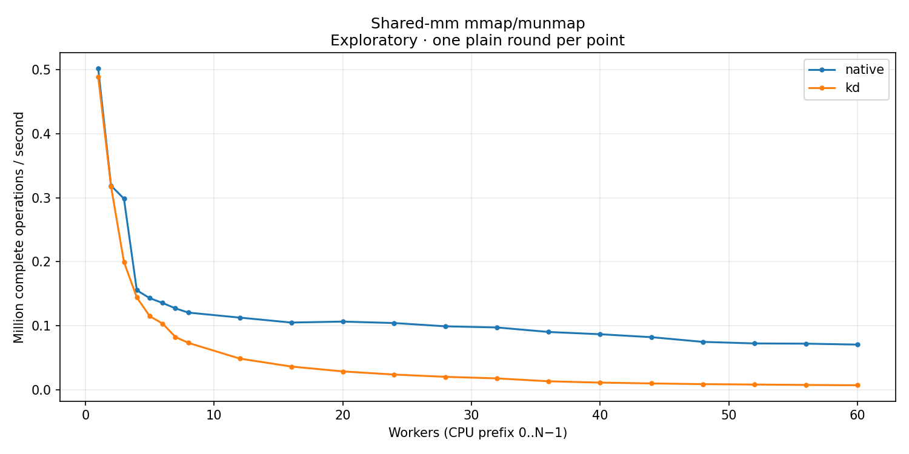

# Shared-mm mmap/munmap

Actual mmap/munmap in one shared address space, on installed kernel `6.1.159-kdmm31` (Build ID `ef5179e8def44f0255adcd62585f62f118fee30f`). Native uses `kd_mmap=off`; KD uses `kd_mmap=on`. Native MM bodies execute on their original tasks. Each point retains the 90-second post-setup interval. These are separate aggregate controls, not an accepted paired campaign. Control-library source `e74223c8c0d0a1f72f2c7d87560b37c3125a23f5`; unchanged timed client SHA-256 `5962210671ac238ae4df8dcca442b3cb7407efb2b5b2edb42ae637ac4902083f`.

Exactly one plain round per point. Strict host timing qualification is failed; auxiliary QEMU workers use CPU 63. No variance estimate or latency samples. Rates use complete operations divided by whole wall time. Missing optional positive-cohort peak windows do not invalidate exact aggregate accounting or drain.

[CSV](table.csv) · [SVG](throughput.svg)

| Workers | native Mops/s | kd Mops/s |
| --- | ---: | ---: |
| 1 | 0.501945 | 0.488891 |
| 2 | 0.318875 | 0.317436 |
| 3 | 0.298560 | 0.199508 |
| 4 | 0.155325 | 0.144195 |
| 5 | 0.143011 | 0.114821 |
| 6 | 0.135475 | 0.103247 |
| 7 | 0.127029 | 0.082226 |
| 8 | 0.120396 | 0.073063 |
| 12 | 0.112551 | 0.048434 |
| 16 | 0.104827 | 0.036010 |
| 20 | 0.106320 | 0.028408 |
| 24 | 0.104046 | 0.023491 |
| 28 | 0.098929 | 0.019908 |
| 32 | 0.097120 | 0.017479 |
| 36 | 0.090086 | 0.012966 |
| 40 | 0.086528 | 0.010899 |
| 44 | 0.081924 | 0.009605 |
| 48 | 0.074589 | 0.008493 |
| 52 | 0.072170 | 0.007886 |
| 56 | 0.071796 | 0.007216 |
| 60 | 0.070351 | 0.006752 |
