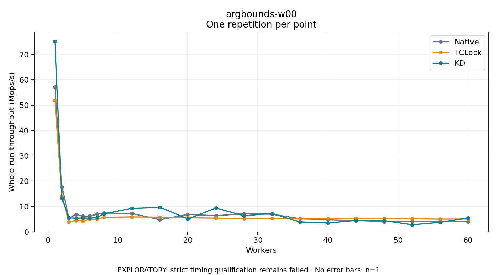

# argbounds-w00

One timed repetition per point; no repeat variability estimate.
EXPLORATORY: strict timing qualification remains failed. Rates include post-lock work. Failed/unrun cases have no plotted rate.

| Workers | Native Mops/s | TCLock Mops/s | KD Mops/s | KD execution |
| ---: | ---: | ---: | ---: | --- |
| 1 | 57.200 | 51.940 | 75.284 | NO_JIT |
| 2 | 17.775 | 14.191 | 13.318 | NO_JIT |
| 3 | 5.514 | 3.950 | 5.606 | NO_JIT |
| 4 | 6.888 | 4.502 | 5.460 | NO_JIT |
| 5 | 6.200 | 4.371 | 5.556 | NO_JIT |
| 6 | 6.300 | 5.008 | 5.477 | NO_JIT |
| 7 | 6.976 | 5.073 | 5.676 | NO_JIT |
| 8 | 7.440 | 5.810 | 7.122 | RETURNED_JIT |
| 12 | 7.256 | 5.953 | 9.297 | RETURNED_JIT |
| 16 | 4.881 | 5.848 | 9.723 | RETURNED_JIT |
| 20 | 6.917 | 5.624 | 5.161 | NO_JIT |
| 24 | 6.410 | 5.499 | 9.400 | RETURNED_JIT |
| 28 | 7.194 | 5.277 | 6.385 | RETURNED_JIT |
| 32 | 6.980 | 5.406 | 7.313 | RETURNED_JIT |
| 36 | 5.281 | 5.133 | 3.930 | RETURNED_JIT |
| 40 | 4.788 | 5.227 | 3.501 | RETURNED_JIT |
| 44 | 4.499 | 5.420 | 4.513 | RETURNED_JIT |
| 48 | 4.050 | 5.377 | 4.436 | RETURNED_JIT |
| 52 | 4.128 | 5.254 | 2.824 | RETURNED_JIT |
| 56 | 4.138 | 5.098 | 3.748 | RETURNED_JIT |
| 60 | 4.001 | 5.146 | 5.545 | RETURNED_JIT |

[Full receipt table](table.csv)

