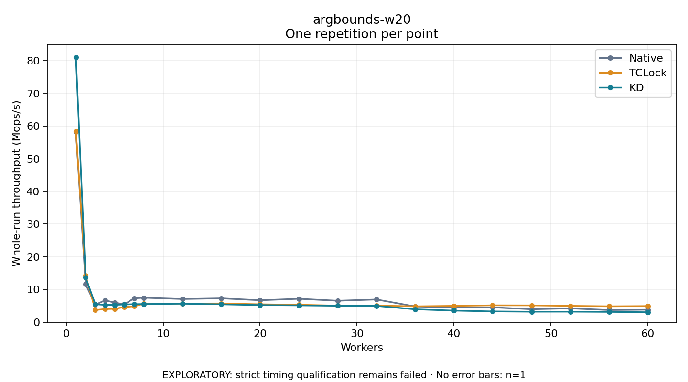

# argbounds-w20

One timed repetition per point; no repeat variability estimate.
EXPLORATORY: strict timing qualification remains failed. Rates include post-lock work. Failed/unrun cases have no plotted rate.

| Workers | Native Mops/s | TCLock Mops/s | KD Mops/s | KD execution |
| ---: | ---: | ---: | ---: | --- |
| 1 | 58.296 | 58.483 | 81.116 | NO_JIT |
| 2 | 11.643 | 14.327 | 13.693 | NO_JIT |
| 3 | 5.324 | 3.718 | 5.489 | NO_JIT |
| 4 | 6.687 | 4.016 | 5.292 | NO_JIT |
| 5 | 5.997 | 4.098 | 5.297 | NO_JIT |
| 6 | 5.457 | 4.616 | 5.414 | NO_JIT |
| 7 | 7.319 | 4.880 | 5.505 | NO_JIT |
| 8 | 7.486 | 5.629 | 5.539 | RETURNED_JIT |
| 12 | 7.095 | 5.693 | 5.652 | NO_JIT |
| 16 | 7.297 | 5.723 | 5.458 | NO_JIT |
| 20 | 6.717 | 5.472 | 5.226 | NO_JIT |
| 24 | 7.161 | 5.330 | 5.141 | RETURNED_JIT |
| 28 | 6.564 | 5.062 | 5.020 | NO_JIT |
| 32 | 6.946 | 5.071 | 4.981 | NO_JIT |
| 36 | 4.814 | 4.852 | 3.947 | NO_JIT |
| 40 | 4.536 | 4.991 | 3.546 | RETURNED_JIT |
| 44 | 4.534 | 5.159 | 3.298 | NO_JIT |
| 48 | 3.975 | 5.139 | 3.212 | RETURNED_JIT |
| 52 | 4.227 | 4.989 | 3.222 | RETURNED_JIT |
| 56 | 3.722 | 4.862 | 3.158 | RETURNED_JIT |
| 60 | 3.831 | 4.926 | 3.052 | RETURNED_JIT |

[Full receipt table](table.csv)

