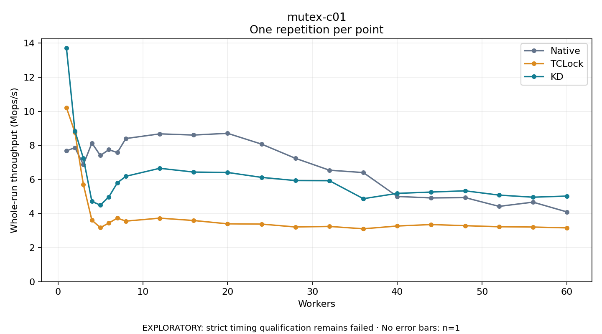

# mutex-c01

One timed repetition per point; no repeat variability estimate.
EXPLORATORY: strict timing qualification remains failed. Rates include post-lock work. Failed/unrun cases have no plotted rate.

| Workers | Native Mops/s | TCLock Mops/s | KD Mops/s | KD execution |
| ---: | ---: | ---: | ---: | --- |
| 1 | 7.675 | 10.219 | 13.720 | NO_JIT |
| 2 | 7.869 | 8.760 | 8.844 | NO_JIT |
| 3 | 6.871 | 5.694 | 7.241 | RETURNED_JIT |
| 4 | 8.139 | 3.611 | 4.710 | RETURNED_JIT |
| 5 | 7.405 | 3.171 | 4.494 | RETURNED_JIT |
| 6 | 7.748 | 3.445 | 4.977 | RETURNED_JIT |
| 7 | 7.577 | 3.733 | 5.800 | RETURNED_JIT |
| 8 | 8.401 | 3.555 | 6.185 | RETURNED_JIT |
| 12 | 8.675 | 3.730 | 6.655 | RETURNED_JIT |
| 16 | 8.606 | 3.591 | 6.433 | RETURNED_JIT |
| 20 | 8.707 | 3.397 | 6.410 | RETURNED_JIT |
| 24 | 8.073 | 3.381 | 6.121 | RETURNED_JIT |
| 28 | 7.239 | 3.212 | 5.935 | RETURNED_JIT |
| 32 | 6.543 | 3.243 | 5.928 | RETURNED_JIT |
| 36 | 6.404 | 3.106 | 4.872 | RETURNED_JIT |
| 40 | 5.001 | 3.268 | 5.183 | RETURNED_JIT |
| 44 | 4.917 | 3.354 | 5.260 | RETURNED_JIT |
| 48 | 4.934 | 3.288 | 5.333 | RETURNED_JIT |
| 52 | 4.420 | 3.225 | 5.081 | RETURNED_JIT |
| 56 | 4.668 | 3.208 | 4.958 | RETURNED_JIT |
| 60 | 4.095 | 3.159 | 5.025 | RETURNED_JIT |

[Full receipt table](table.csv)

