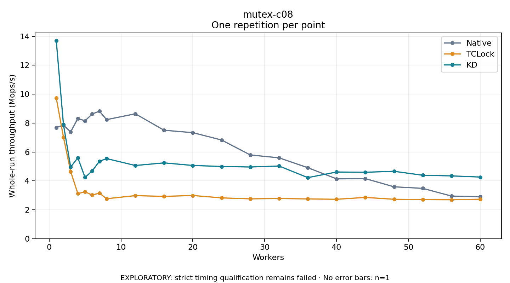

# mutex-c08

One timed repetition per point; no repeat variability estimate.
EXPLORATORY: strict timing qualification remains failed. Rates include post-lock work. Failed/unrun cases have no plotted rate.

| Workers | Native Mops/s | TCLock Mops/s | KD Mops/s | KD execution |
| ---: | ---: | ---: | ---: | --- |
| 1 | 7.690 | 9.735 | 13.689 | NO_JIT |
| 2 | 7.860 | 7.027 | 7.892 | RETURNED_JIT |
| 3 | 7.387 | 4.653 | 4.958 | RETURNED_JIT |
| 4 | 8.321 | 3.119 | 5.597 | RETURNED_JIT |
| 5 | 8.156 | 3.241 | 4.241 | RETURNED_JIT |
| 6 | 8.630 | 3.020 | 4.688 | RETURNED_JIT |
| 7 | 8.823 | 3.155 | 5.356 | RETURNED_JIT |
| 8 | 8.237 | 2.765 | 5.543 | RETURNED_JIT |
| 12 | 8.643 | 2.980 | 5.065 | RETURNED_JIT |
| 16 | 7.505 | 2.927 | 5.246 | RETURNED_JIT |
| 20 | 7.336 | 2.990 | 5.067 | RETURNED_JIT |
| 24 | 6.829 | 2.823 | 4.997 | RETURNED_JIT |
| 28 | 5.794 | 2.757 | 4.960 | RETURNED_JIT |
| 32 | 5.595 | 2.781 | 5.029 | RETURNED_JIT |
| 36 | 4.912 | 2.751 | 4.226 | RETURNED_JIT |
| 40 | 4.139 | 2.728 | 4.613 | RETURNED_JIT |
| 44 | 4.159 | 2.856 | 4.597 | RETURNED_JIT |
| 48 | 3.590 | 2.728 | 4.663 | RETURNED_JIT |
| 52 | 3.482 | 2.704 | 4.389 | RETURNED_JIT |
| 56 | 2.948 | 2.694 | 4.345 | RETURNED_JIT |
| 60 | 2.905 | 2.732 | 4.265 | RETURNED_JIT |

[Full receipt table](table.csv)

