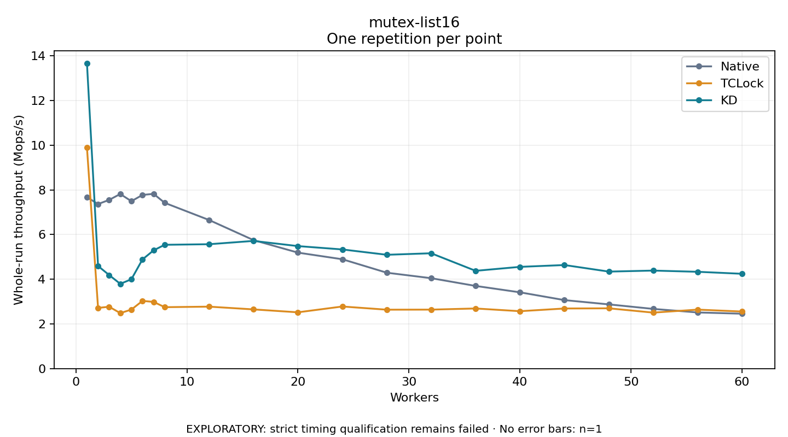

# mutex-list16

One timed repetition per point; no repeat variability estimate.
EXPLORATORY: strict timing qualification remains failed. Rates include post-lock work. Failed/unrun cases have no plotted rate.

| Workers | Native Mops/s | TCLock Mops/s | KD Mops/s | KD execution |
| ---: | ---: | ---: | ---: | --- |
| 1 | 7.671 | 9.891 | 13.661 | NO_JIT |
| 2 | 7.363 | 2.716 | 4.591 | RETURNED_JIT |
| 3 | 7.550 | 2.769 | 4.186 | RETURNED_JIT |
| 4 | 7.813 | 2.482 | 3.793 | RETURNED_JIT |
| 5 | 7.490 | 2.641 | 3.997 | RETURNED_JIT |
| 6 | 7.772 | 3.029 | 4.886 | RETURNED_JIT |
| 7 | 7.821 | 2.985 | 5.290 | RETURNED_JIT |
| 8 | 7.418 | 2.748 | 5.541 | RETURNED_JIT |
| 12 | 6.649 | 2.772 | 5.566 | RETURNED_JIT |
| 16 | 5.750 | 2.649 | 5.714 | RETURNED_JIT |
| 20 | 5.189 | 2.518 | 5.482 | RETURNED_JIT |
| 24 | 4.893 | 2.779 | 5.332 | RETURNED_JIT |
| 28 | 4.291 | 2.636 | 5.093 | RETURNED_JIT |
| 32 | 4.046 | 2.639 | 5.161 | RETURNED_JIT |
| 36 | 3.699 | 2.690 | 4.375 | RETURNED_JIT |
| 40 | 3.413 | 2.568 | 4.553 | RETURNED_JIT |
| 44 | 3.065 | 2.690 | 4.634 | RETURNED_JIT |
| 48 | 2.873 | 2.697 | 4.341 | RETURNED_JIT |
| 52 | 2.671 | 2.505 | 4.386 | RETURNED_JIT |
| 56 | 2.512 | 2.639 | 4.332 | RETURNED_JIT |
| 60 | 2.456 | 2.553 | 4.243 | RETURNED_JIT |

[Full receipt table](table.csv)

