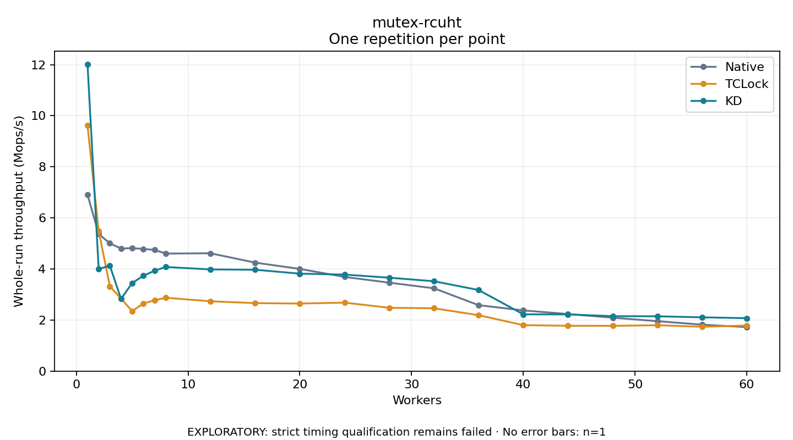

# mutex-rcuht

One timed repetition per point; no repeat variability estimate.
EXPLORATORY: strict timing qualification remains failed. Rates include post-lock work. Failed/unrun cases have no plotted rate.

| Workers | Native Mops/s | TCLock Mops/s | KD Mops/s | KD execution |
| ---: | ---: | ---: | ---: | --- |
| 1 | 6.909 | 9.618 | 12.016 | NO_JIT |
| 2 | 5.370 | 5.492 | 3.994 | RETURNED_JIT |
| 3 | 5.005 | 3.319 | 4.134 | RETURNED_JIT |
| 4 | 4.800 | 2.841 | 2.828 | RETURNED_JIT |
| 5 | 4.817 | 2.346 | 3.452 | RETURNED_JIT |
| 6 | 4.785 | 2.650 | 3.733 | RETURNED_JIT |
| 7 | 4.747 | 2.775 | 3.932 | RETURNED_JIT |
| 8 | 4.603 | 2.874 | 4.077 | RETURNED_JIT |
| 12 | 4.615 | 2.735 | 3.984 | RETURNED_JIT |
| 16 | 4.249 | 2.663 | 3.970 | RETURNED_JIT |
| 20 | 4.003 | 2.646 | 3.817 | RETURNED_JIT |
| 24 | 3.689 | 2.682 | 3.780 | RETURNED_JIT |
| 28 | 3.464 | 2.480 | 3.658 | RETURNED_JIT |
| 32 | 3.243 | 2.462 | 3.520 | RETURNED_JIT |
| 36 | 2.583 | 2.190 | 3.177 | RETURNED_JIT |
| 40 | 2.378 | 1.800 | 2.224 | RETURNED_JIT |
| 44 | 2.235 | 1.775 | 2.221 | RETURNED_JIT |
| 48 | 2.093 | 1.773 | 2.152 | RETURNED_JIT |
| 52 | 1.956 | 1.797 | 2.147 | RETURNED_JIT |
| 56 | 1.820 | 1.738 | 2.107 | RETURNED_JIT |
| 60 | 1.723 | 1.784 | 2.073 | RETURNED_JIT |

[Full receipt table](table.csv)

