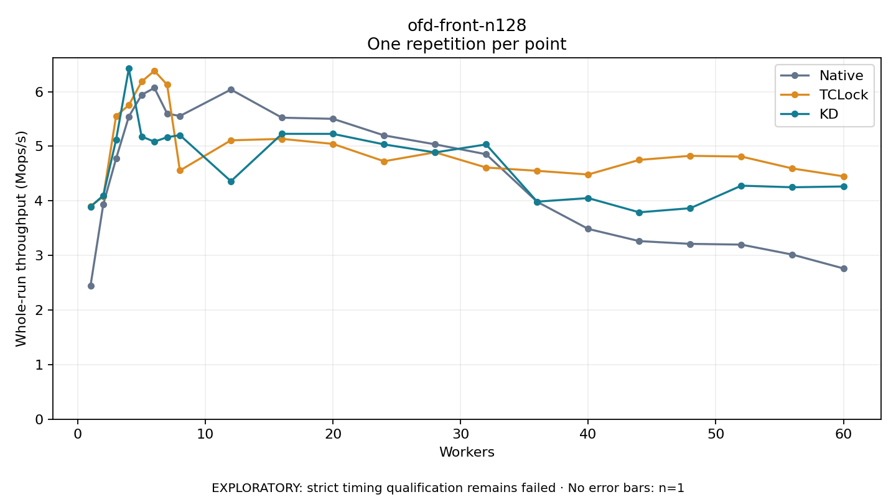

# ofd-front-n128

One timed repetition per point; no repeat variability estimate.
EXPLORATORY: strict timing qualification remains failed. Rates include post-lock work. Failed/unrun cases have no plotted rate.

| Workers | Native Mops/s | TCLock Mops/s | KD Mops/s | KD execution |
| ---: | ---: | ---: | ---: | --- |
| 1 | 2.450 | 3.901 | 3.894 | NO_JIT |
| 2 | 3.938 | 4.082 | 4.099 | NO_JIT |
| 3 | 4.773 | 5.554 | 5.118 | NO_JIT |
| 4 | 5.544 | 5.753 | 6.422 | NO_JIT |
| 5 | 5.940 | 6.183 | 5.178 | NO_JIT |
| 6 | 6.069 | 6.381 | 5.084 | NO_JIT |
| 7 | 5.599 | 6.128 | 5.165 | NO_JIT |
| 8 | 5.553 | 4.555 | 5.203 | NO_JIT |
| 12 | 6.038 | 5.108 | 4.359 | RETURNED_JIT |
| 16 | 5.523 | 5.135 | 5.227 | RETURNED_JIT |
| 20 | 5.502 | 5.043 | 5.227 | RETURNED_JIT |
| 24 | 5.199 | 4.725 | 5.034 | RETURNED_JIT |
| 28 | 5.035 | 4.889 | 4.886 | RETURNED_JIT |
| 32 | 4.853 | 4.610 | 5.033 | RETURNED_JIT |
| 36 | 3.982 | 4.550 | 3.985 | RETURNED_JIT |
| 40 | 3.486 | 4.482 | 4.050 | RETURNED_JIT |
| 44 | 3.262 | 4.750 | 3.790 | RETURNED_JIT |
| 48 | 3.212 | 4.824 | 3.865 | RETURNED_JIT |
| 52 | 3.198 | 4.811 | 4.278 | RETURNED_JIT |
| 56 | 3.015 | 4.593 | 4.249 | RETURNED_JIT |
| 60 | 2.762 | 4.449 | 4.263 | RETURNED_JIT |

[Full receipt table](table.csv)

