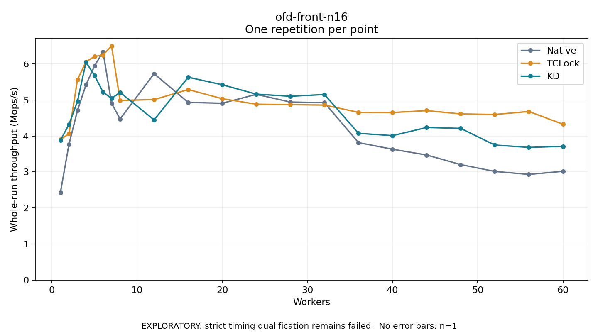

# ofd-front-n16

One timed repetition per point; no repeat variability estimate.
EXPLORATORY: strict timing qualification remains failed. Rates include post-lock work. Failed/unrun cases have no plotted rate.

| Workers | Native Mops/s | TCLock Mops/s | KD Mops/s | KD execution |
| ---: | ---: | ---: | ---: | --- |
| 1 | 2.434 | 3.902 | 3.882 | NO_JIT |
| 2 | 3.768 | 4.061 | 4.320 | NO_JIT |
| 3 | 4.710 | 5.567 | 4.964 | NO_JIT |
| 4 | 5.423 | 6.065 | 6.052 | NO_JIT |
| 5 | 5.947 | 6.208 | 5.682 | NO_JIT |
| 6 | 6.339 | 6.249 | 5.221 | NO_JIT |
| 7 | 4.912 | 6.502 | 5.043 | NO_JIT |
| 8 | 4.473 | 4.989 | 5.212 | NO_JIT |
| 12 | 5.731 | 5.011 | 4.449 | RETURNED_JIT |
| 16 | 4.933 | 5.290 | 5.633 | RETURNED_JIT |
| 20 | 4.910 | 5.037 | 5.424 | RETURNED_JIT |
| 24 | 5.157 | 4.884 | 5.163 | RETURNED_JIT |
| 28 | 4.943 | 4.870 | 5.104 | RETURNED_JIT |
| 32 | 4.925 | 4.859 | 5.153 | RETURNED_JIT |
| 36 | 3.816 | 4.658 | 4.074 | RETURNED_JIT |
| 40 | 3.632 | 4.652 | 4.010 | RETURNED_JIT |
| 44 | 3.472 | 4.706 | 4.236 | RETURNED_JIT |
| 48 | 3.206 | 4.614 | 4.212 | RETURNED_JIT |
| 52 | 3.016 | 4.597 | 3.750 | RETURNED_JIT |
| 56 | 2.933 | 4.682 | 3.684 | RETURNED_JIT |
| 60 | 3.019 | 4.328 | 3.714 | RETURNED_JIT |

[Full receipt table](table.csv)

