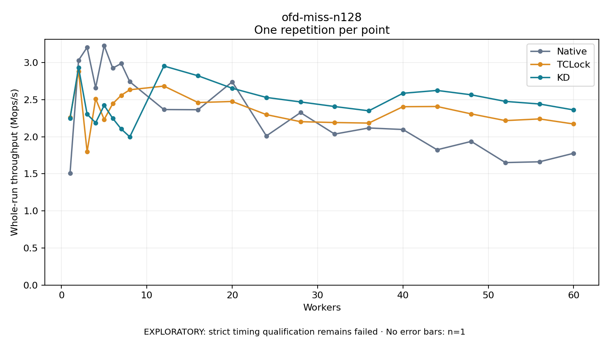

# ofd-miss-n128

One timed repetition per point; no repeat variability estimate.
EXPLORATORY: strict timing qualification remains failed. Rates include post-lock work. Failed/unrun cases have no plotted rate.

| Workers | Native Mops/s | TCLock Mops/s | KD Mops/s | KD execution |
| ---: | ---: | ---: | ---: | --- |
| 1 | 1.506 | 2.262 | 2.246 | NO_JIT |
| 2 | 3.030 | 2.883 | 2.933 | NO_JIT |
| 3 | 3.205 | 1.797 | 2.304 | NO_JIT |
| 4 | 2.660 | 2.512 | 2.188 | NO_JIT |
| 5 | 3.227 | 2.233 | 2.423 | NO_JIT |
| 6 | 2.925 | 2.445 | 2.248 | NO_JIT |
| 7 | 2.987 | 2.559 | 2.104 | NO_JIT |
| 8 | 2.741 | 2.633 | 1.998 | RETURNED_JIT |
| 12 | 2.366 | 2.683 | 2.953 | RETURNED_JIT |
| 16 | 2.364 | 2.461 | 2.821 | RETURNED_JIT |
| 20 | 2.740 | 2.475 | 2.653 | RETURNED_JIT |
| 24 | 2.011 | 2.298 | 2.529 | RETURNED_JIT |
| 28 | 2.325 | 2.203 | 2.469 | RETURNED_JIT |
| 32 | 2.035 | 2.191 | 2.407 | RETURNED_JIT |
| 36 | 2.118 | 2.184 | 2.349 | RETURNED_JIT |
| 40 | 2.097 | 2.405 | 2.585 | RETURNED_JIT |
| 44 | 1.824 | 2.407 | 2.624 | RETURNED_JIT |
| 48 | 1.937 | 2.308 | 2.565 | RETURNED_JIT |
| 52 | 1.651 | 2.217 | 2.476 | RETURNED_JIT |
| 56 | 1.662 | 2.240 | 2.441 | RETURNED_JIT |
| 60 | 1.777 | 2.172 | 2.361 | RETURNED_JIT |

[Full receipt table](table.csv)

