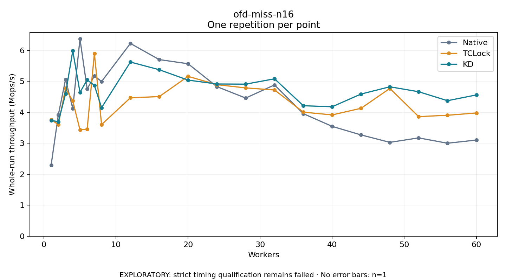

# ofd-miss-n16

One timed repetition per point; no repeat variability estimate.
EXPLORATORY: strict timing qualification remains failed. Rates include post-lock work. Failed/unrun cases have no plotted rate.

| Workers | Native Mops/s | TCLock Mops/s | KD Mops/s | KD execution |
| ---: | ---: | ---: | ---: | --- |
| 1 | 2.296 | 3.757 | 3.737 | NO_JIT |
| 2 | 3.917 | 3.603 | 3.695 | NO_JIT |
| 3 | 5.060 | 4.771 | 4.593 | NO_JIT |
| 4 | 4.122 | 4.365 | 5.984 | NO_JIT |
| 5 | 6.369 | 3.429 | 4.641 | NO_JIT |
| 6 | 4.751 | 3.459 | 5.048 | NO_JIT |
| 7 | 5.171 | 5.896 | 4.866 | NO_JIT |
| 8 | 4.992 | 3.603 | 4.149 | RETURNED_JIT |
| 12 | 6.221 | 4.467 | 5.621 | RETURNED_JIT |
| 16 | 5.700 | 4.505 | 5.373 | RETURNED_JIT |
| 20 | 5.566 | 5.158 | 5.038 | RETURNED_JIT |
| 24 | 4.827 | 4.891 | 4.912 | RETURNED_JIT |
| 28 | 4.458 | 4.786 | 4.908 | RETURNED_JIT |
| 32 | 4.883 | 4.718 | 5.079 | RETURNED_JIT |
| 36 | 3.954 | 4.003 | 4.210 | RETURNED_JIT |
| 40 | 3.544 | 3.914 | 4.178 | RETURNED_JIT |
| 44 | 3.269 | 4.127 | 4.588 | RETURNED_JIT |
| 48 | 3.029 | 4.769 | 4.822 | RETURNED_JIT |
| 52 | 3.172 | 3.859 | 4.663 | RETURNED_JIT |
| 56 | 3.000 | 3.903 | 4.373 | RETURNED_JIT |
| 60 | 3.102 | 3.976 | 4.558 | RETURNED_JIT |

[Full receipt table](table.csv)

