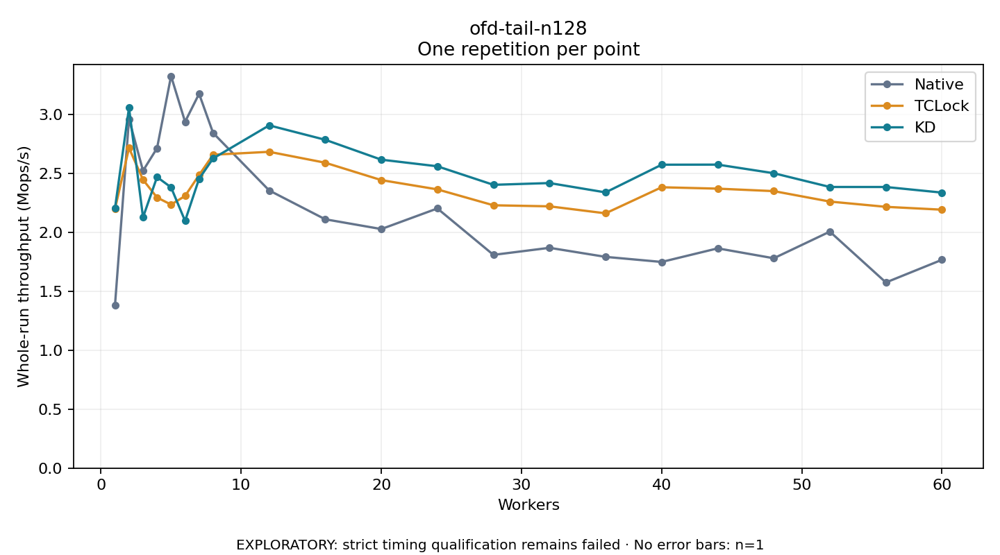

# ofd-tail-n128

One timed repetition per point; no repeat variability estimate.
EXPLORATORY: strict timing qualification remains failed. Rates include post-lock work. Failed/unrun cases have no plotted rate.

| Workers | Native Mops/s | TCLock Mops/s | KD Mops/s | KD execution |
| ---: | ---: | ---: | ---: | --- |
| 1 | 1.383 | 2.201 | 2.206 | NO_JIT |
| 2 | 2.963 | 2.718 | 3.059 | NO_JIT |
| 3 | 2.524 | 2.448 | 2.129 | NO_JIT |
| 4 | 2.716 | 2.297 | 2.471 | NO_JIT |
| 5 | 3.328 | 2.237 | 2.383 | NO_JIT |
| 6 | 2.940 | 2.310 | 2.098 | NO_JIT |
| 7 | 3.177 | 2.488 | 2.456 | NO_JIT |
| 8 | 2.845 | 2.660 | 2.629 | RETURNED_JIT |
| 12 | 2.357 | 2.685 | 2.909 | RETURNED_JIT |
| 16 | 2.112 | 2.592 | 2.787 | RETURNED_JIT |
| 20 | 2.029 | 2.445 | 2.618 | RETURNED_JIT |
| 24 | 2.204 | 2.366 | 2.562 | RETURNED_JIT |
| 28 | 1.810 | 2.231 | 2.405 | RETURNED_JIT |
| 32 | 1.870 | 2.222 | 2.420 | RETURNED_JIT |
| 36 | 1.793 | 2.163 | 2.340 | RETURNED_JIT |
| 40 | 1.750 | 2.384 | 2.575 | RETURNED_JIT |
| 44 | 1.865 | 2.372 | 2.576 | RETURNED_JIT |
| 48 | 1.781 | 2.351 | 2.503 | RETURNED_JIT |
| 52 | 2.007 | 2.263 | 2.386 | RETURNED_JIT |
| 56 | 1.576 | 2.218 | 2.386 | RETURNED_JIT |
| 60 | 1.768 | 2.194 | 2.339 | RETURNED_JIT |

[Full receipt table](table.csv)

