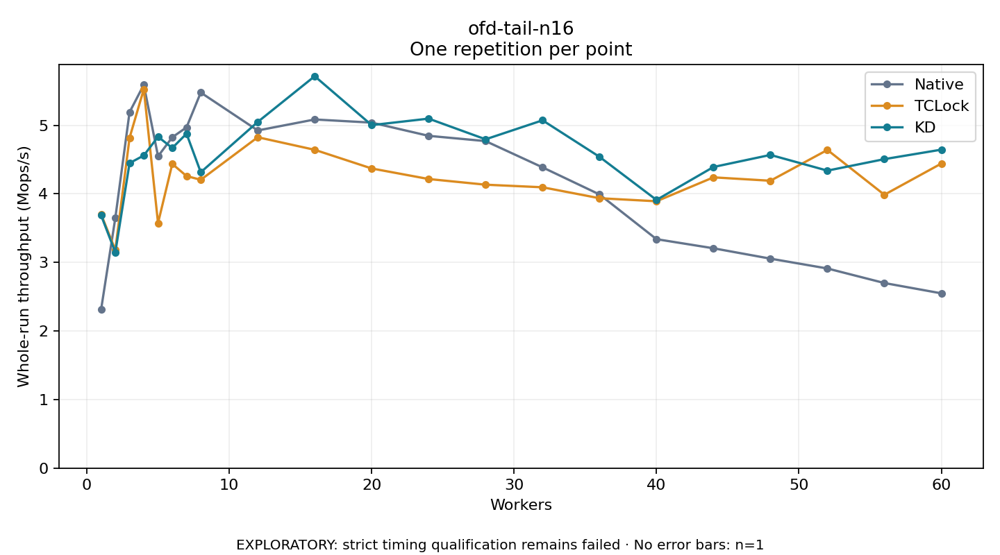

# ofd-tail-n16

One timed repetition per point; no repeat variability estimate.
EXPLORATORY: strict timing qualification remains failed. Rates include post-lock work. Failed/unrun cases have no plotted rate.

| Workers | Native Mops/s | TCLock Mops/s | KD Mops/s | KD execution |
| ---: | ---: | ---: | ---: | --- |
| 1 | 2.310 | 3.704 | 3.689 | NO_JIT |
| 2 | 3.648 | 3.182 | 3.147 | NO_JIT |
| 3 | 5.192 | 4.818 | 4.449 | NO_JIT |
| 4 | 5.592 | 5.528 | 4.560 | NO_JIT |
| 5 | 4.549 | 3.575 | 4.833 | NO_JIT |
| 6 | 4.826 | 4.437 | 4.670 | NO_JIT |
| 7 | 4.971 | 4.261 | 4.878 | NO_JIT |
| 8 | 5.478 | 4.206 | 4.316 | RETURNED_JIT |
| 12 | 4.925 | 4.827 | 5.050 | RETURNED_JIT |
| 16 | 5.086 | 4.643 | 5.717 | RETURNED_JIT |
| 20 | 5.040 | 4.371 | 5.003 | RETURNED_JIT |
| 24 | 4.847 | 4.217 | 5.098 | RETURNED_JIT |
| 28 | 4.770 | 4.134 | 4.796 | RETURNED_JIT |
| 32 | 4.387 | 4.097 | 5.073 | RETURNED_JIT |
| 36 | 3.992 | 3.937 | 4.540 | RETURNED_JIT |
| 40 | 3.339 | 3.892 | 3.912 | RETURNED_JIT |
| 44 | 3.207 | 4.241 | 4.392 | RETURNED_JIT |
| 48 | 3.055 | 4.192 | 4.569 | RETURNED_JIT |
| 52 | 2.912 | 4.641 | 4.339 | RETURNED_JIT |
| 56 | 2.700 | 3.987 | 4.507 | RETURNED_JIT |
| 60 | 2.550 | 4.443 | 4.645 | RETURNED_JIT |

[Full receipt table](table.csv)

