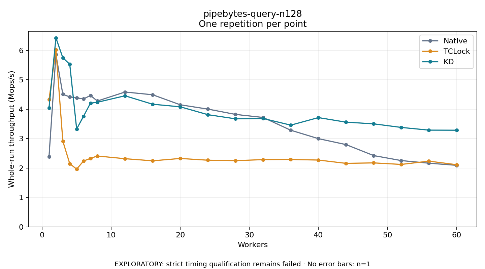

# pipebytes-query-n128

One timed repetition per point; no repeat variability estimate.
EXPLORATORY: strict timing qualification remains failed. Rates include post-lock work. Failed/unrun cases have no plotted rate.

| Workers | Native Mops/s | TCLock Mops/s | KD Mops/s | KD execution |
| ---: | ---: | ---: | ---: | --- |
| 1 | 2.391 | 4.327 | 4.050 | NO_JIT |
| 2 | 5.861 | 6.029 | 6.429 | NO_JIT |
| 3 | 4.509 | 2.916 | 5.751 | NO_JIT |
| 4 | 4.420 | 2.150 | 5.533 | RETURNED_JIT |
| 5 | 4.387 | 1.965 | 3.328 | RETURNED_JIT |
| 6 | 4.352 | 2.241 | 3.763 | RETURNED_JIT |
| 7 | 4.469 | 2.330 | 4.207 | RETURNED_JIT |
| 8 | 4.281 | 2.410 | 4.238 | RETURNED_JIT |
| 12 | 4.586 | 2.319 | 4.458 | RETURNED_JIT |
| 16 | 4.493 | 2.247 | 4.171 | RETURNED_JIT |
| 20 | 4.152 | 2.327 | 4.083 | RETURNED_JIT |
| 24 | 4.005 | 2.268 | 3.816 | RETURNED_JIT |
| 28 | 3.825 | 2.252 | 3.675 | RETURNED_JIT |
| 32 | 3.721 | 2.288 | 3.686 | RETURNED_JIT |
| 36 | 3.287 | 2.291 | 3.460 | RETURNED_JIT |
| 40 | 3.001 | 2.273 | 3.717 | RETURNED_JIT |
| 44 | 2.798 | 2.160 | 3.561 | RETURNED_JIT |
| 48 | 2.425 | 2.176 | 3.504 | RETURNED_JIT |
| 52 | 2.255 | 2.124 | 3.382 | RETURNED_JIT |
| 56 | 2.166 | 2.236 | 3.290 | RETURNED_JIT |
| 60 | 2.094 | 2.115 | 3.287 | RETURNED_JIT |

[Full receipt table](table.csv)

