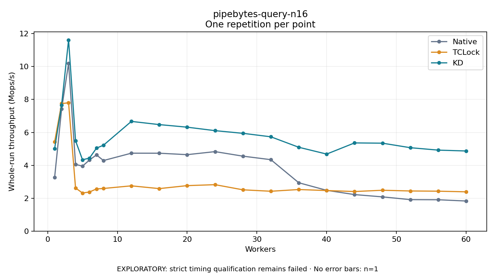

# pipebytes-query-n16

One timed repetition per point; no repeat variability estimate.
EXPLORATORY: strict timing qualification remains failed. Rates include post-lock work. Failed/unrun cases have no plotted rate.

| Workers | Native Mops/s | TCLock Mops/s | KD Mops/s | KD execution |
| ---: | ---: | ---: | ---: | --- |
| 1 | 3.267 | 5.426 | 5.013 | NO_JIT |
| 2 | 7.418 | 7.753 | 7.665 | NO_JIT |
| 3 | 10.196 | 7.798 | 11.621 | NO_JIT |
| 4 | 4.054 | 2.621 | 5.488 | RETURNED_JIT |
| 5 | 3.950 | 2.315 | 4.335 | RETURNED_JIT |
| 6 | 4.323 | 2.378 | 4.440 | RETURNED_JIT |
| 7 | 4.633 | 2.565 | 5.044 | RETURNED_JIT |
| 8 | 4.289 | 2.592 | 5.220 | RETURNED_JIT |
| 12 | 4.736 | 2.752 | 6.668 | RETURNED_JIT |
| 16 | 4.734 | 2.583 | 6.474 | RETURNED_JIT |
| 20 | 4.647 | 2.764 | 6.317 | RETURNED_JIT |
| 24 | 4.831 | 2.823 | 6.106 | RETURNED_JIT |
| 28 | 4.555 | 2.509 | 5.944 | RETURNED_JIT |
| 32 | 4.342 | 2.422 | 5.732 | RETURNED_JIT |
| 36 | 2.939 | 2.527 | 5.096 | RETURNED_JIT |
| 40 | 2.479 | 2.465 | 4.682 | RETURNED_JIT |
| 44 | 2.220 | 2.406 | 5.361 | RETURNED_JIT |
| 48 | 2.081 | 2.483 | 5.344 | RETURNED_JIT |
| 52 | 1.913 | 2.439 | 5.069 | RETURNED_JIT |
| 56 | 1.906 | 2.426 | 4.923 | RETURNED_JIT |
| 60 | 1.829 | 2.388 | 4.870 | RETURNED_JIT |

[Full receipt table](table.csv)

