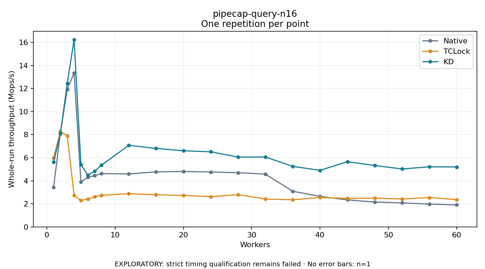

# pipecap-query-n16

One timed repetition per point; no repeat variability estimate.
EXPLORATORY: strict timing qualification remains failed. Rates include post-lock work. Failed/unrun cases have no plotted rate.

| Workers | Native Mops/s | TCLock Mops/s | KD Mops/s | KD execution |
| ---: | ---: | ---: | ---: | --- |
| 1 | 3.430 | 5.981 | 5.609 | NO_JIT |
| 2 | 8.191 | 8.278 | 8.098 | NO_JIT |
| 3 | 11.922 | 7.907 | 12.434 | NO_JIT |
| 4 | 13.342 | 2.722 | 16.244 | NO_JIT |
| 5 | 3.894 | 2.293 | 5.404 | RETURNED_JIT |
| 6 | 4.298 | 2.421 | 4.497 | RETURNED_JIT |
| 7 | 4.442 | 2.606 | 4.825 | RETURNED_JIT |
| 8 | 4.622 | 2.737 | 5.353 | RETURNED_JIT |
| 12 | 4.590 | 2.881 | 7.071 | RETURNED_JIT |
| 16 | 4.770 | 2.793 | 6.803 | RETURNED_JIT |
| 20 | 4.804 | 2.720 | 6.600 | RETURNED_JIT |
| 24 | 4.759 | 2.621 | 6.512 | RETURNED_JIT |
| 28 | 4.699 | 2.794 | 6.052 | RETURNED_JIT |
| 32 | 4.571 | 2.417 | 6.061 | RETURNED_JIT |
| 36 | 3.090 | 2.349 | 5.244 | RETURNED_JIT |
| 40 | 2.641 | 2.550 | 4.905 | RETURNED_JIT |
| 44 | 2.342 | 2.467 | 5.647 | RETURNED_JIT |
| 48 | 2.151 | 2.487 | 5.321 | RETURNED_JIT |
| 52 | 2.083 | 2.423 | 5.024 | RETURNED_JIT |
| 56 | 1.976 | 2.537 | 5.208 | RETURNED_JIT |
| 60 | 1.903 | 2.368 | 5.193 | RETURNED_JIT |

[Full receipt table](table.csv)

