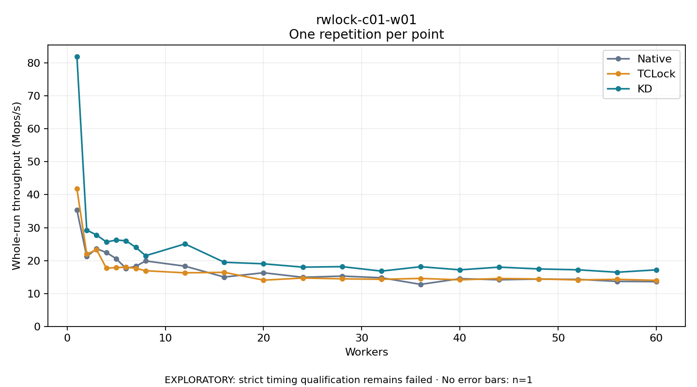

# rwlock-c01-w01

One timed repetition per point; no repeat variability estimate.
EXPLORATORY: strict timing qualification remains failed. Rates include post-lock work. Failed/unrun cases have no plotted rate.

| Workers | Native Mops/s | TCLock Mops/s | KD Mops/s | KD execution |
| ---: | ---: | ---: | ---: | --- |
| 1 | 35.355 | 41.798 | 82.003 | NO_JIT |
| 2 | 21.220 | 21.952 | 29.266 | NO_JIT |
| 3 | 23.601 | 23.303 | 27.769 | NO_JIT |
| 4 | 22.442 | 17.675 | 25.641 | NO_JIT |
| 5 | 20.571 | 17.880 | 26.237 | NO_JIT |
| 6 | 17.594 | 17.987 | 26.009 | NO_JIT |
| 7 | 18.279 | 17.650 | 24.003 | NO_JIT |
| 8 | 19.886 | 16.905 | 21.472 | NO_JIT |
| 12 | 18.299 | 16.271 | 25.059 | NO_JIT |
| 16 | 14.992 | 16.426 | 19.481 | NO_JIT |
| 20 | 16.297 | 14.048 | 19.019 | RETURNED_JIT |
| 24 | 14.913 | 14.691 | 17.999 | RETURNED_JIT |
| 28 | 15.283 | 14.455 | 18.151 | RETURNED_JIT |
| 32 | 14.780 | 14.304 | 16.794 | RETURNED_JIT |
| 36 | 12.766 | 14.576 | 18.129 | RETURNED_JIT |
| 40 | 14.500 | 14.144 | 17.182 | RETURNED_JIT |
| 44 | 14.163 | 14.552 | 18.003 | RETURNED_JIT |
| 48 | 14.380 | 14.409 | 17.460 | RETURNED_JIT |
| 52 | 14.279 | 14.121 | 17.190 | RETURNED_JIT |
| 56 | 13.679 | 14.305 | 16.452 | RETURNED_JIT |
| 60 | 13.589 | 13.987 | 17.174 | RETURNED_JIT |

[Full receipt table](table.csv)

