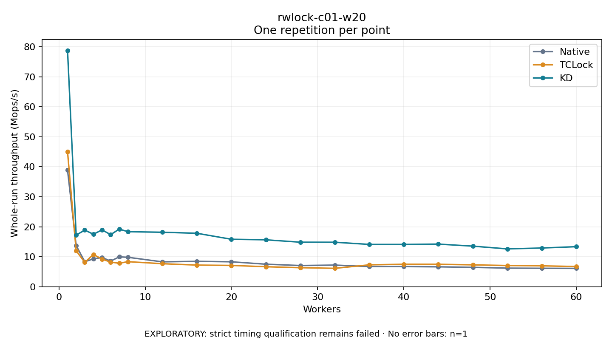

# rwlock-c01-w20

One timed repetition per point; no repeat variability estimate.
EXPLORATORY: strict timing qualification remains failed. Rates include post-lock work. Failed/unrun cases have no plotted rate.

| Workers | Native Mops/s | TCLock Mops/s | KD Mops/s | KD execution |
| ---: | ---: | ---: | ---: | --- |
| 1 | 38.918 | 45.030 | 78.778 | NO_JIT |
| 2 | 13.748 | 12.023 | 17.221 | NO_JIT |
| 3 | 8.360 | 8.126 | 18.888 | NO_JIT |
| 4 | 9.297 | 10.773 | 17.514 | NO_JIT |
| 5 | 9.754 | 9.214 | 18.963 | NO_JIT |
| 6 | 8.572 | 8.221 | 17.376 | NO_JIT |
| 7 | 9.965 | 7.839 | 19.231 | NO_JIT |
| 8 | 9.828 | 8.368 | 18.356 | NO_JIT |
| 12 | 8.305 | 7.687 | 18.174 | RETURNED_JIT |
| 16 | 8.488 | 7.228 | 17.831 | RETURNED_JIT |
| 20 | 8.322 | 7.115 | 15.835 | RETURNED_JIT |
| 24 | 7.526 | 6.680 | 15.653 | RETURNED_JIT |
| 28 | 7.081 | 6.357 | 14.859 | RETURNED_JIT |
| 32 | 7.229 | 6.148 | 14.844 | RETURNED_JIT |
| 36 | 6.725 | 7.316 | 14.118 | RETURNED_JIT |
| 40 | 6.725 | 7.512 | 14.122 | NO_JIT |
| 44 | 6.649 | 7.507 | 14.227 | RETURNED_JIT |
| 48 | 6.478 | 7.306 | 13.539 | NO_JIT |
| 52 | 6.211 | 7.083 | 12.627 | NO_JIT |
| 56 | 6.168 | 6.977 | 12.923 | NO_JIT |
| 60 | 6.129 | 6.749 | 13.366 | NO_JIT |

[Full receipt table](table.csv)

