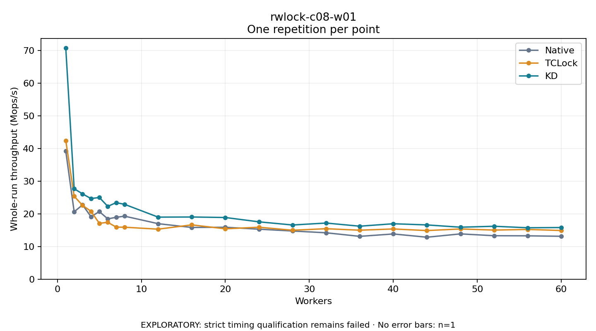

# rwlock-c08-w01

One timed repetition per point; no repeat variability estimate.
EXPLORATORY: strict timing qualification remains failed. Rates include post-lock work. Failed/unrun cases have no plotted rate.

| Workers | Native Mops/s | TCLock Mops/s | KD Mops/s | KD execution |
| ---: | ---: | ---: | ---: | --- |
| 1 | 39.160 | 42.402 | 70.714 | NO_JIT |
| 2 | 20.609 | 25.351 | 27.664 | NO_JIT |
| 3 | 22.726 | 22.575 | 26.087 | NO_JIT |
| 4 | 19.113 | 20.759 | 24.654 | NO_JIT |
| 5 | 20.671 | 17.074 | 24.985 | NO_JIT |
| 6 | 18.444 | 17.396 | 22.266 | NO_JIT |
| 7 | 18.919 | 15.920 | 23.401 | NO_JIT |
| 8 | 19.273 | 15.891 | 22.893 | NO_JIT |
| 12 | 16.975 | 15.297 | 18.975 | NO_JIT |
| 16 | 15.818 | 16.608 | 19.015 | NO_JIT |
| 20 | 15.878 | 15.403 | 18.862 | RETURNED_JIT |
| 24 | 15.291 | 15.887 | 17.537 | RETURNED_JIT |
| 28 | 14.733 | 14.969 | 16.571 | RETURNED_JIT |
| 32 | 14.190 | 15.434 | 17.166 | RETURNED_JIT |
| 36 | 13.099 | 14.979 | 16.205 | RETURNED_JIT |
| 40 | 13.830 | 15.358 | 16.952 | RETURNED_JIT |
| 44 | 12.834 | 14.866 | 16.595 | RETURNED_JIT |
| 48 | 13.850 | 15.358 | 15.892 | RETURNED_JIT |
| 52 | 13.291 | 15.014 | 16.183 | RETURNED_JIT |
| 56 | 13.262 | 15.214 | 15.722 | RETURNED_JIT |
| 60 | 13.117 | 14.888 | 15.795 | RETURNED_JIT |

[Full receipt table](table.csv)

