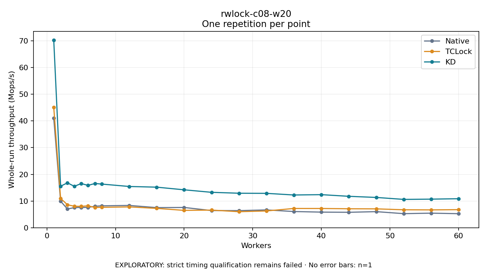

# rwlock-c08-w20

One timed repetition per point; no repeat variability estimate.
EXPLORATORY: strict timing qualification remains failed. Rates include post-lock work. Failed/unrun cases have no plotted rate.

| Workers | Native Mops/s | TCLock Mops/s | KD Mops/s | KD execution |
| ---: | ---: | ---: | ---: | --- |
| 1 | 41.056 | 45.140 | 70.292 | NO_JIT |
| 2 | 9.939 | 10.989 | 15.563 | NO_JIT |
| 3 | 7.005 | 8.602 | 16.814 | NO_JIT |
| 4 | 7.546 | 8.042 | 15.510 | NO_JIT |
| 5 | 7.592 | 8.008 | 16.552 | NO_JIT |
| 6 | 7.608 | 8.206 | 15.855 | NO_JIT |
| 7 | 8.046 | 7.586 | 16.576 | NO_JIT |
| 8 | 8.202 | 7.641 | 16.350 | NO_JIT |
| 12 | 8.355 | 7.804 | 15.452 | RETURNED_JIT |
| 16 | 7.530 | 7.246 | 15.197 | RETURNED_JIT |
| 20 | 7.593 | 6.503 | 14.204 | RETURNED_JIT |
| 24 | 6.429 | 6.606 | 13.264 | RETURNED_JIT |
| 28 | 6.408 | 6.003 | 12.923 | RETURNED_JIT |
| 32 | 6.668 | 6.284 | 12.878 | RETURNED_JIT |
| 36 | 6.069 | 7.219 | 12.262 | RETURNED_JIT |
| 40 | 5.848 | 7.213 | 12.391 | RETURNED_JIT |
| 44 | 5.786 | 7.100 | 11.769 | RETURNED_JIT |
| 48 | 6.025 | 7.068 | 11.347 | NO_JIT |
| 52 | 5.272 | 6.726 | 10.614 | NO_JIT |
| 56 | 5.458 | 6.685 | 10.708 | NO_JIT |
| 60 | 5.261 | 6.767 | 10.870 | NO_JIT |

[Full receipt table](table.csv)

