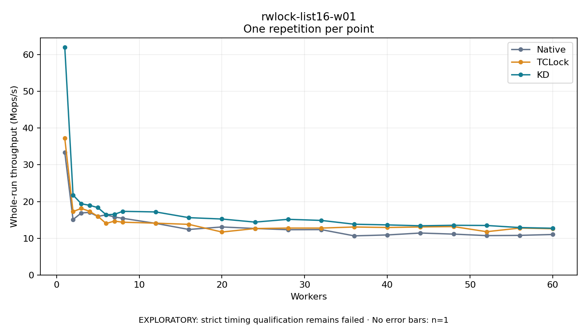

# rwlock-list16-w01

One timed repetition per point; no repeat variability estimate.
EXPLORATORY: strict timing qualification remains failed. Rates include post-lock work. Failed/unrun cases have no plotted rate.

| Workers | Native Mops/s | TCLock Mops/s | KD Mops/s | KD execution |
| ---: | ---: | ---: | ---: | --- |
| 1 | 33.373 | 37.232 | 61.993 | NO_JIT |
| 2 | 15.082 | 17.261 | 21.770 | NO_JIT |
| 3 | 16.896 | 18.129 | 19.388 | NO_JIT |
| 4 | 17.039 | 17.331 | 18.967 | NO_JIT |
| 5 | 15.927 | 15.968 | 18.345 | NO_JIT |
| 6 | 16.392 | 14.018 | 16.400 | NO_JIT |
| 7 | 15.775 | 14.672 | 16.500 | NO_JIT |
| 8 | 15.434 | 14.370 | 17.330 | NO_JIT |
| 12 | 14.045 | 14.106 | 17.165 | NO_JIT |
| 16 | 12.392 | 13.782 | 15.608 | NO_JIT |
| 20 | 13.076 | 11.693 | 15.236 | RETURNED_JIT |
| 24 | 12.653 | 12.645 | 14.393 | RETURNED_JIT |
| 28 | 12.321 | 12.770 | 15.154 | RETURNED_JIT |
| 32 | 12.346 | 12.767 | 14.856 | RETURNED_JIT |
| 36 | 10.649 | 13.067 | 13.819 | RETURNED_JIT |
| 40 | 10.899 | 12.926 | 13.636 | RETURNED_JIT |
| 44 | 11.421 | 13.080 | 13.392 | RETURNED_JIT |
| 48 | 11.126 | 13.177 | 13.530 | RETURNED_JIT |
| 52 | 10.717 | 11.783 | 13.477 | RETURNED_JIT |
| 56 | 10.785 | 12.774 | 12.911 | RETURNED_JIT |
| 60 | 11.023 | 12.592 | 12.723 | RETURNED_JIT |

[Full receipt table](table.csv)

