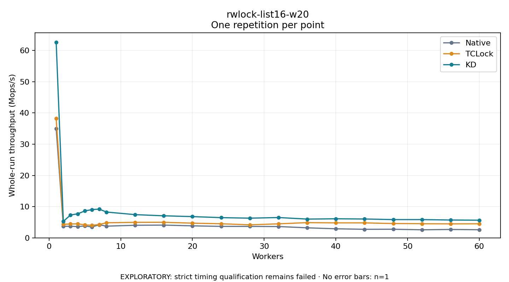

# rwlock-list16-w20

One timed repetition per point; no repeat variability estimate.
EXPLORATORY: strict timing qualification remains failed. Rates include post-lock work. Failed/unrun cases have no plotted rate.

| Workers | Native Mops/s | TCLock Mops/s | KD Mops/s | KD execution |
| ---: | ---: | ---: | ---: | --- |
| 1 | 34.996 | 38.202 | 62.640 | NO_JIT |
| 2 | 3.685 | 4.323 | 5.275 | NO_JIT |
| 3 | 3.709 | 4.432 | 7.309 | NO_JIT |
| 4 | 3.608 | 4.502 | 7.696 | NO_JIT |
| 5 | 3.809 | 4.146 | 8.619 | NO_JIT |
| 6 | 3.491 | 4.020 | 9.043 | NO_JIT |
| 7 | 4.195 | 4.263 | 9.209 | NO_JIT |
| 8 | 3.750 | 4.831 | 8.263 | NO_JIT |
| 12 | 4.025 | 4.961 | 7.432 | RETURNED_JIT |
| 16 | 4.082 | 4.979 | 7.060 | RETURNED_JIT |
| 20 | 3.845 | 4.705 | 6.801 | RETURNED_JIT |
| 24 | 3.673 | 4.510 | 6.472 | RETURNED_JIT |
| 28 | 3.655 | 4.167 | 6.300 | RETURNED_JIT |
| 32 | 3.623 | 4.490 | 6.505 | RETURNED_JIT |
| 36 | 3.212 | 4.872 | 6.007 | RETURNED_JIT |
| 40 | 2.900 | 4.799 | 6.103 | RETURNED_JIT |
| 44 | 2.736 | 4.792 | 6.034 | RETURNED_JIT |
| 48 | 2.758 | 4.581 | 5.845 | RETURNED_JIT |
| 52 | 2.583 | 4.522 | 5.840 | RETURNED_JIT |
| 56 | 2.687 | 4.480 | 5.711 | RETURNED_JIT |
| 60 | 2.597 | 4.503 | 5.651 | RETURNED_JIT |

[Full receipt table](table.csv)

