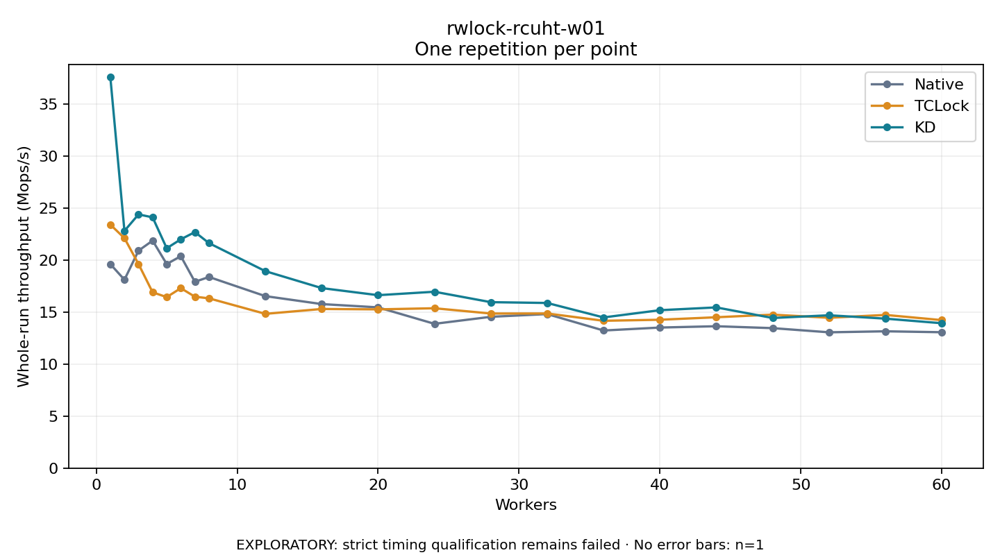

# rwlock-rcuht-w01

One timed repetition per point; no repeat variability estimate.
EXPLORATORY: strict timing qualification remains failed. Rates include post-lock work. Failed/unrun cases have no plotted rate.

| Workers | Native Mops/s | TCLock Mops/s | KD Mops/s | KD execution |
| ---: | ---: | ---: | ---: | --- |
| 1 | 19.631 | 23.429 | 37.605 | NO_JIT |
| 2 | 18.126 | 22.127 | 22.827 | NO_JIT |
| 3 | 20.926 | 19.630 | 24.413 | NO_JIT |
| 4 | 21.889 | 16.916 | 24.128 | NO_JIT |
| 5 | 19.634 | 16.454 | 21.154 | NO_JIT |
| 6 | 20.394 | 17.314 | 22.016 | NO_JIT |
| 7 | 17.928 | 16.493 | 22.710 | NO_JIT |
| 8 | 18.391 | 16.335 | 21.648 | NO_JIT |
| 12 | 16.547 | 14.844 | 18.950 | NO_JIT |
| 16 | 15.783 | 15.312 | 17.321 | NO_JIT |
| 20 | 15.466 | 15.275 | 16.639 | RETURNED_JIT |
| 24 | 13.883 | 15.382 | 16.971 | RETURNED_JIT |
| 28 | 14.559 | 14.874 | 15.968 | RETURNED_JIT |
| 32 | 14.822 | 14.879 | 15.890 | RETURNED_JIT |
| 36 | 13.240 | 14.176 | 14.499 | RETURNED_JIT |
| 40 | 13.525 | 14.276 | 15.195 | RETURNED_JIT |
| 44 | 13.652 | 14.515 | 15.463 | RETURNED_JIT |
| 48 | 13.468 | 14.768 | 14.444 | RETURNED_JIT |
| 52 | 13.067 | 14.465 | 14.706 | RETURNED_JIT |
| 56 | 13.164 | 14.741 | 14.383 | RETURNED_JIT |
| 60 | 13.074 | 14.240 | 13.940 | RETURNED_JIT |

[Full receipt table](table.csv)

