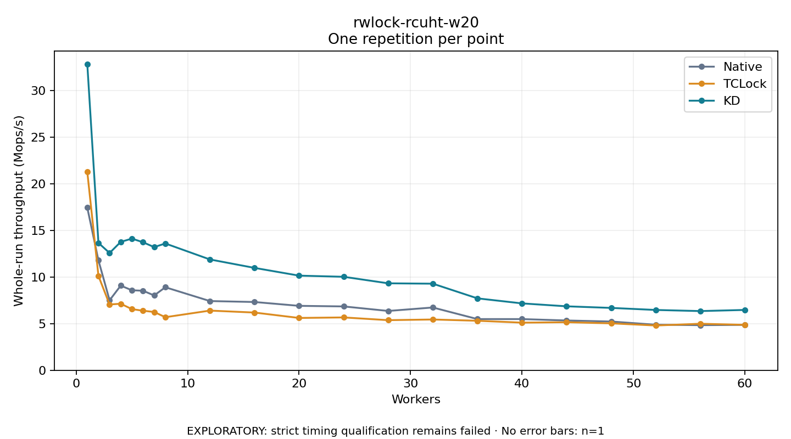

# rwlock-rcuht-w20

One timed repetition per point; no repeat variability estimate.
EXPLORATORY: strict timing qualification remains failed. Rates include post-lock work. Failed/unrun cases have no plotted rate.

| Workers | Native Mops/s | TCLock Mops/s | KD Mops/s | KD execution |
| ---: | ---: | ---: | ---: | --- |
| 1 | 17.448 | 21.284 | 32.847 | NO_JIT |
| 2 | 11.800 | 10.127 | 13.663 | NO_JIT |
| 3 | 7.511 | 7.059 | 12.584 | NO_JIT |
| 4 | 9.084 | 7.139 | 13.772 | NO_JIT |
| 5 | 8.583 | 6.560 | 14.126 | NO_JIT |
| 6 | 8.534 | 6.389 | 13.735 | NO_JIT |
| 7 | 8.029 | 6.255 | 13.213 | NO_JIT |
| 8 | 8.908 | 5.694 | 13.604 | NO_JIT |
| 12 | 7.426 | 6.403 | 11.890 | RETURNED_JIT |
| 16 | 7.324 | 6.193 | 10.985 | RETURNED_JIT |
| 20 | 6.913 | 5.613 | 10.153 | RETURNED_JIT |
| 24 | 6.850 | 5.670 | 10.029 | RETURNED_JIT |
| 28 | 6.365 | 5.376 | 9.329 | RETURNED_JIT |
| 32 | 6.735 | 5.448 | 9.290 | RETURNED_JIT |
| 36 | 5.493 | 5.312 | 7.716 | RETURNED_JIT |
| 40 | 5.492 | 5.110 | 7.176 | RETURNED_JIT |
| 44 | 5.342 | 5.155 | 6.862 | RETURNED_JIT |
| 48 | 5.231 | 5.037 | 6.691 | RETURNED_JIT |
| 52 | 4.887 | 4.802 | 6.471 | RETURNED_JIT |
| 56 | 4.840 | 4.992 | 6.351 | RETURNED_JIT |
| 60 | 4.869 | 4.873 | 6.474 | RETURNED_JIT |

[Full receipt table](table.csv)

