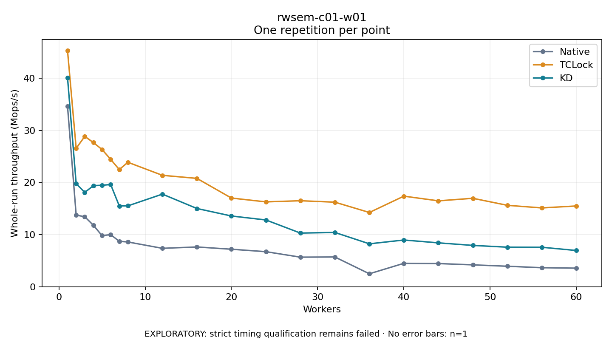

# rwsem-c01-w01

One timed repetition per point; no repeat variability estimate.
EXPLORATORY: strict timing qualification remains failed. Rates include post-lock work. Failed/unrun cases have no plotted rate.

| Workers | Native Mops/s | TCLock Mops/s | KD Mops/s | KD execution |
| ---: | ---: | ---: | ---: | --- |
| 1 | 34.585 | 45.265 | 40.081 | NO_JIT |
| 2 | 13.746 | 26.540 | 19.768 | NO_JIT |
| 3 | 13.427 | 28.836 | 18.098 | NO_JIT |
| 4 | 11.786 | 27.647 | 19.390 | NO_JIT |
| 5 | 9.804 | 26.322 | 19.462 | NO_JIT |
| 6 | 10.001 | 24.431 | 19.610 | NO_JIT |
| 7 | 8.715 | 22.473 | 15.501 | NO_JIT |
| 8 | 8.590 | 23.869 | 15.514 | NO_JIT |
| 12 | 7.372 | 21.368 | 17.763 | NO_JIT |
| 16 | 7.633 | 20.783 | 15.010 | NO_JIT |
| 20 | 7.198 | 17.011 | 13.570 | NO_JIT |
| 24 | 6.728 | 16.277 | 12.811 | NO_JIT |
| 28 | 5.677 | 16.496 | 10.297 | NO_JIT |
| 32 | 5.709 | 16.221 | 10.414 | NO_JIT |
| 36 | 2.490 | 14.243 | 8.235 | NO_JIT |
| 40 | 4.498 | 17.375 | 8.966 | NO_JIT |
| 44 | 4.451 | 16.477 | 8.420 | NO_JIT |
| 48 | 4.202 | 16.963 | 7.929 | NO_JIT |
| 52 | 3.935 | 15.618 | 7.592 | NO_JIT |
| 56 | 3.654 | 15.118 | 7.577 | NO_JIT |
| 60 | 3.569 | 15.494 | 6.954 | NO_JIT |

[Full receipt table](table.csv)

