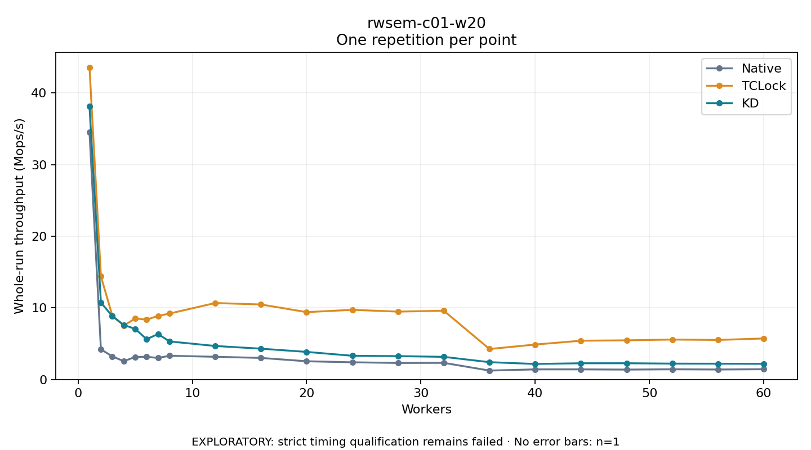

# rwsem-c01-w20

One timed repetition per point; no repeat variability estimate.
EXPLORATORY: strict timing qualification remains failed. Rates include post-lock work. Failed/unrun cases have no plotted rate.

| Workers | Native Mops/s | TCLock Mops/s | KD Mops/s | KD execution |
| ---: | ---: | ---: | ---: | --- |
| 1 | 34.531 | 43.548 | 38.090 | NO_JIT |
| 2 | 4.215 | 14.397 | 10.749 | NO_JIT |
| 3 | 3.233 | 8.893 | 8.844 | NO_JIT |
| 4 | 2.559 | 7.521 | 7.618 | NO_JIT |
| 5 | 3.158 | 8.527 | 7.071 | NO_JIT |
| 6 | 3.173 | 8.352 | 5.628 | RETURNED_JIT |
| 7 | 3.017 | 8.885 | 6.351 | NO_JIT |
| 8 | 3.320 | 9.208 | 5.319 | NO_JIT |
| 12 | 3.176 | 10.679 | 4.685 | RETURNED_JIT |
| 16 | 3.018 | 10.476 | 4.309 | RETURNED_JIT |
| 20 | 2.552 | 9.410 | 3.858 | RETURNED_JIT |
| 24 | 2.409 | 9.728 | 3.319 | RETURNED_JIT |
| 28 | 2.316 | 9.480 | 3.270 | RETURNED_JIT |
| 32 | 2.333 | 9.606 | 3.167 | RETURNED_JIT |
| 36 | 1.252 | 4.260 | 2.425 | RETURNED_JIT |
| 40 | 1.420 | 4.886 | 2.175 | RETURNED_JIT |
| 44 | 1.419 | 5.419 | 2.273 | RETURNED_JIT |
| 48 | 1.389 | 5.473 | 2.277 | RETURNED_JIT |
| 52 | 1.430 | 5.581 | 2.223 | RETURNED_JIT |
| 56 | 1.401 | 5.526 | 2.211 | RETURNED_JIT |
| 60 | 1.441 | 5.732 | 2.195 | RETURNED_JIT |

[Full receipt table](table.csv)

