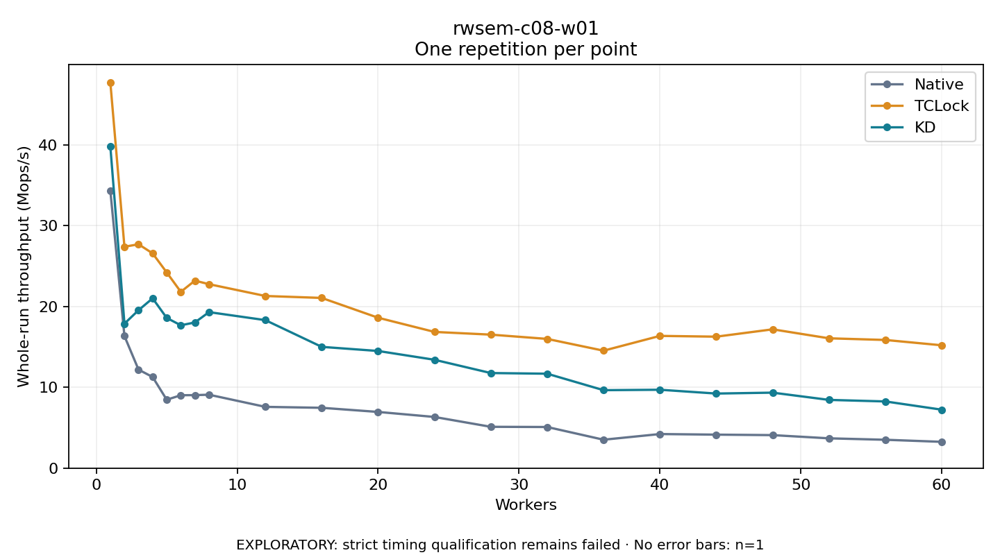

# rwsem-c08-w01

One timed repetition per point; no repeat variability estimate.
EXPLORATORY: strict timing qualification remains failed. Rates include post-lock work. Failed/unrun cases have no plotted rate.

| Workers | Native Mops/s | TCLock Mops/s | KD Mops/s | KD execution |
| ---: | ---: | ---: | ---: | --- |
| 1 | 34.335 | 47.744 | 39.819 | NO_JIT |
| 2 | 16.350 | 27.407 | 17.887 | NO_JIT |
| 3 | 12.192 | 27.714 | 19.553 | NO_JIT |
| 4 | 11.281 | 26.587 | 21.021 | NO_JIT |
| 5 | 8.468 | 24.226 | 18.597 | NO_JIT |
| 6 | 9.022 | 21.824 | 17.683 | NO_JIT |
| 7 | 9.037 | 23.213 | 18.035 | NO_JIT |
| 8 | 9.089 | 22.773 | 19.313 | NO_JIT |
| 12 | 7.583 | 21.312 | 18.322 | NO_JIT |
| 16 | 7.467 | 21.070 | 15.012 | NO_JIT |
| 20 | 6.956 | 18.619 | 14.503 | NO_JIT |
| 24 | 6.334 | 16.863 | 13.414 | NO_JIT |
| 28 | 5.114 | 16.526 | 11.770 | NO_JIT |
| 32 | 5.090 | 15.997 | 11.689 | NO_JIT |
| 36 | 3.516 | 14.539 | 9.649 | NO_JIT |
| 40 | 4.218 | 16.370 | 9.702 | NO_JIT |
| 44 | 4.144 | 16.274 | 9.231 | NO_JIT |
| 48 | 4.085 | 17.184 | 9.344 | NO_JIT |
| 52 | 3.687 | 16.070 | 8.445 | NO_JIT |
| 56 | 3.509 | 15.867 | 8.255 | NO_JIT |
| 60 | 3.254 | 15.207 | 7.234 | NO_JIT |

[Full receipt table](table.csv)

