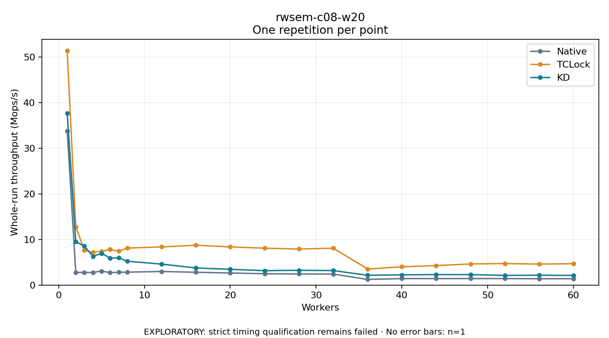

# rwsem-c08-w20

One timed repetition per point; no repeat variability estimate.
EXPLORATORY: strict timing qualification remains failed. Rates include post-lock work. Failed/unrun cases have no plotted rate.

| Workers | Native Mops/s | TCLock Mops/s | KD Mops/s | KD execution |
| ---: | ---: | ---: | ---: | --- |
| 1 | 33.832 | 51.397 | 37.708 | NO_JIT |
| 2 | 2.795 | 12.750 | 9.488 | NO_JIT |
| 3 | 2.767 | 7.644 | 8.558 | NO_JIT |
| 4 | 2.765 | 7.184 | 6.287 | RETURNED_JIT |
| 5 | 3.079 | 7.420 | 6.961 | RETURNED_JIT |
| 6 | 2.723 | 7.808 | 5.943 | RETURNED_JIT |
| 7 | 2.816 | 7.438 | 5.962 | RETURNED_JIT |
| 8 | 2.833 | 8.119 | 5.230 | RETURNED_JIT |
| 12 | 2.986 | 8.365 | 4.602 | RETURNED_JIT |
| 16 | 2.811 | 8.744 | 3.754 | RETURNED_JIT |
| 20 | 2.647 | 8.367 | 3.458 | RETURNED_JIT |
| 24 | 2.495 | 8.097 | 3.160 | RETURNED_JIT |
| 28 | 2.434 | 7.906 | 3.250 | RETURNED_JIT |
| 32 | 2.419 | 8.095 | 3.179 | RETURNED_JIT |
| 36 | 1.236 | 3.530 | 2.156 | RETURNED_JIT |
| 40 | 1.422 | 4.009 | 2.240 | RETURNED_JIT |
| 44 | 1.424 | 4.281 | 2.304 | RETURNED_JIT |
| 48 | 1.425 | 4.634 | 2.297 | RETURNED_JIT |
| 52 | 1.425 | 4.722 | 2.120 | RETURNED_JIT |
| 56 | 1.389 | 4.601 | 2.168 | RETURNED_JIT |
| 60 | 1.398 | 4.698 | 2.112 | RETURNED_JIT |

[Full receipt table](table.csv)

