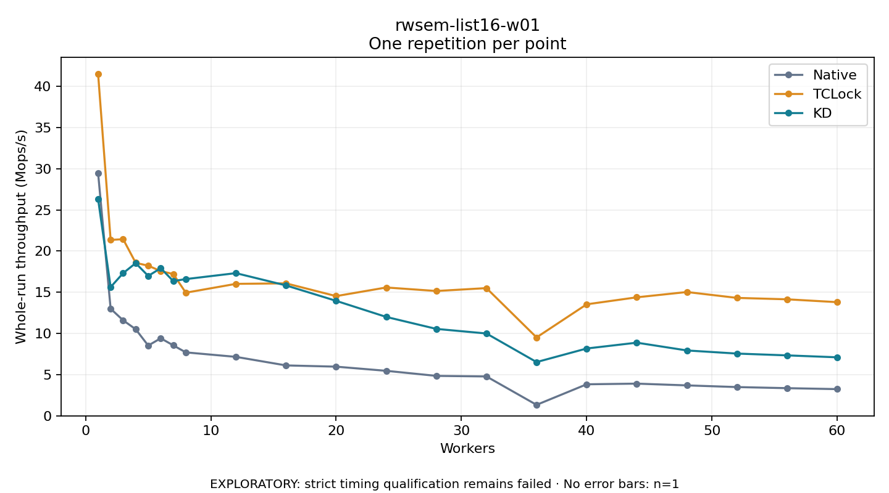

# rwsem-list16-w01

One timed repetition per point; no repeat variability estimate.
EXPLORATORY: strict timing qualification remains failed. Rates include post-lock work. Failed/unrun cases have no plotted rate.

| Workers | Native Mops/s | TCLock Mops/s | KD Mops/s | KD execution |
| ---: | ---: | ---: | ---: | --- |
| 1 | 29.468 | 41.510 | 26.311 | NO_JIT |
| 2 | 12.998 | 21.352 | 15.627 | NO_JIT |
| 3 | 11.592 | 21.440 | 17.322 | NO_JIT |
| 4 | 10.513 | 18.573 | 18.535 | NO_JIT |
| 5 | 8.530 | 18.223 | 16.981 | NO_JIT |
| 6 | 9.414 | 17.569 | 17.921 | NO_JIT |
| 7 | 8.553 | 17.214 | 16.357 | NO_JIT |
| 8 | 7.702 | 14.946 | 16.597 | NO_JIT |
| 12 | 7.158 | 16.019 | 17.320 | NO_JIT |
| 16 | 6.119 | 16.081 | 15.829 | NO_JIT |
| 20 | 5.968 | 14.532 | 13.958 | NO_JIT |
| 24 | 5.463 | 15.579 | 12.005 | NO_JIT |
| 28 | 4.849 | 15.153 | 10.551 | NO_JIT |
| 32 | 4.780 | 15.503 | 9.994 | NO_JIT |
| 36 | 1.331 | 9.518 | 6.524 | NO_JIT |
| 40 | 3.827 | 13.537 | 8.172 | NO_JIT |
| 44 | 3.908 | 14.386 | 8.879 | NO_JIT |
| 48 | 3.694 | 15.027 | 7.936 | NO_JIT |
| 52 | 3.490 | 14.315 | 7.556 | NO_JIT |
| 56 | 3.357 | 14.143 | 7.337 | NO_JIT |
| 60 | 3.241 | 13.798 | 7.103 | NO_JIT |

[Full receipt table](table.csv)

